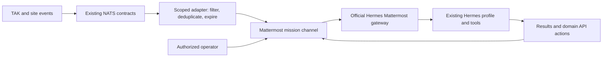

# Mattermost + TAK: deferred operations-workspace plan

Recorded November 1, 2026, from Zeus’s explicit direction: preserve a serious,
detailed future option; **do not deploy it now**. This is a planning record, not
adoption of Mattermost, a purchased entitlement, a working TAK plugin or an
amendment to the current NATS doctrine. All acceptance criteria below are unexecuted.

## Decision and scope

Keep Mattermost under active consideration for human/agent coordination around
TAK, site incidents, field maintenance, infrastructure outages and future robotics.
Matrix remains an existing communication option; XMPP is separately deferred for
TAK Chat interoperability. Preserve choices until an actual operator workflow wins.

This PR adds documentation and a roadmap link only. It must add no Argo Application,
Helm values, Kubernetes resource, plugin binary, credential, bot, webhook, radio
configuration, NATS subject, command permission or public endpoint. No vendor
contact, purchase, deployment, identity change or data migration is authorized by
this plan. Merging these notes cannot deploy a service. Do not reuse an older
batch’s merge or deployment approvals for future implementation.

## Verified evidence versus unresolved distribution

The supplied [Mattermost announcement, June 24, 2024](https://mattermost.com/newsroom/press-releases/mattermost-braingu-gotenna-tactical-chatops/)
reports completed AFRL SBIR Phase II work with BrainGu: TAK/ATAK tactical ChatOps,
plus goTenna low-bandwidth transport integration. It supports a delivered partner
project, not a claim that an ordinary Docker install includes that software.

The [government award record](https://www.sbir.gov/awards/206233) records contract
FA8750-22-C-1012, a 2022 Phase II award scheduled through April 17, 2024, for TAK chat
modernization. This corroborates the funded project; the abstract itself is not
an independent acceptance test or a public software-distribution license.

The [2026 mission-operations datasheet](https://mattermost.com/wp-content/uploads/2026/02/Mattermost-for-Mission-Operations-Datasheet.pdf)
positions TAK interoperability, edge/DDIL operation and sovereign hosting as product
capabilities. Treat these as vendor claims to qualify against exact builds,
network conditions and entitlements. They are not proof on OneMind’s equipment.

Public-source review did not establish a maintained TAK plugin repository, signed
APK/server artifact, public download, current compatibility matrix, install guide,
license, price or support lifecycle. **Free availability is unknown; it is also
incorrect to assert the TAK plugin is necessarily paid.** Recheck before acting.
No vendor was contacted. This plan does not reconstruct an unavailable proprietary
plugin or assume its historical project continues unchanged.

### Questions to resolve before selecting the partner integration

- Who supplies/supports the current integration: Mattermost, BrainGu, goTenna or
  another distributor? Which artifact runs in ATAK, TAK Server and Mattermost?
- Is it generally available, restricted, discontinued or delivered only through
  services? What are the source/binary rights, redistribution limits and costs?
- Which ATAK-CIV/MIL/WinTAK/iTAK and TAK Server versions, signing channels and
  CPU/Android versions are supported? Do not assume every TAK client is supported.
- Which functions are actually bridged: DMs/rooms, GeoChat, files, urgency/read
  receipts, location/context, task links, offline queues or only selected events?
- How are accounts, certificates, device identities, room membership and encryption
  mapped? Which identity authorizes every write, and where can content be decrypted?
- What can cross a low-bandwidth link, with what size/rate/TTL limits? Which radio,
  firmware, SDK, accessory and commercial entitlement is required? goTenna delivery
  does not establish compatibility with Meshtastic, another mesh or ordinary IP.
- What are maintenance/update, vulnerability response, compatibility and data-export
  commitments? Preserve the ability to remove the adapter without losing chat/data.

Record dated answers and actual terms before implementation; contacting a vendor
or entering an agreement requires a separate user instruction.

## Edition and plugin boundaries

Current documentation is version-sensitive; this table is research, not a purchased
feature inventory. The recorded local test was Mattermost 12.0.1 Enterprise running
unlicensed Entry, not automatically Team Edition and not evidence of a cluster app.

| Capability | Boundary to preserve |
| --- | --- |
| REST v4, bots, webhooks, plugin architecture | Ordinary integration foundations; plugins are supported on Team and Enterprise. Individual plugin rights/features can differ. |
| Team Edition | Free core-chat route; current docs describe small teams without SSO. Not the same feature set or history policy as Entry. |
| Entry | Free mode of Enterprise binary; 10,000 visible/searchable channel-message history, with older records retained in DB. Not HA/compliance entitlement. |
| Entry preview limits | Board/Playbook/Agents/Calls/push caps are partly starred as future enforcement. Do not assert all are already enforced in the local version. |
| Enterprise/Advanced | Production HA, compliance/export/retention, granular governance and advanced sovereign controls depend on edition/terms. Entry can preview selected commercial capabilities; not every advanced feature is simply absent. |
| Playbooks and Calls | Separate version/service/edition review. A public Playbooks repository includes differently licensed portions; source visibility grants no blanket production entitlement. |
| FIPS/air-gap claims | Exact validated image, dependencies, deployment and plugin boundaries matter. Installing generic Docker/Kubernetes software is not certification or disconnected readiness. |

Sources: [editions](https://docs.mattermost.com/product-overview/editions-and-offerings),
[plugin architecture](https://docs.mattermost.com/developers/integrate/plugins/using-and-managing-plugins),
[Entry explanation](https://mattermost.com/blog/introducing-mattermost-entry/),
[Playbooks source](https://github.com/mattermost/mattermost-plugin-playbooks),
[Calls](https://docs.mattermost.com/end-user-guide/collaborate/make-calls),
[FIPS/STIG images](https://docs.mattermost.com/deployment-guide/server/containers/fips-stig).
Recheck all entitlements at the eventual decision date; no spend is approved here.

## Proposed OneMind role and ownership

Mattermost would be an operations conversation surface, not another agent runtime,
map server, device authority, task database or durable event bus. Examples: discuss
a water/power incident, coordinate a field inspection, review equipment readiness,
share an approved camera/map link, or receive an incident brief from Hermes.

| System | Keep its responsibility |
| --- | --- |
| TAK/CloudTAK | Operational map, CoT and TAK-native context. |
| NATS/JetStream | Existing event/command contracts and durable delivery where configured. |
| Hermes/Legacy | Agent reasoning, memory, skills and authorized tools. |
| Mattermost | Human conversations, threads, selected notifications and acknowledgements. |
| ClickUp | Current personal/business/project task direction; link tasks rather than duplicate their state. |
| Backstage | Catalog, runbooks, application inventory and existing controlled operator surfaces. |
| Mumble/LiveKit | Existing/proposed voice and real-time media roles; no automatic Mattermost PTT/video substitution. |
| Matrix/XMPP | Alternative/complementary messaging; explicit bridges only, no automatic cross-posting. |

The basic future path can work without obtaining the historical TAK plugin:

This diagram is proposed, not implemented. The separate vendor TAK client/plugin
route, if available, needs its own tested identity and transport design. A webhook
posting an alert is not equivalent to bidirectional native GeoChat interoperability.

## Hermes, sessions and vision

The [official Hermes Mattermost gateway](https://hermes-agent.nousresearch.com/docs/user-guide/messaging/mattermost)
uses REST/WebSocket messaging and the normal Hermes pipeline. Bundled manifests
were observed in deployed Legacy 0.21.5 and Hermes 0.22.5 source trees on November 1;
configuration/enabled state and a working Mattermost conversation were not tested.
DMs, threads and per-user channel sessions can remain separate; profile-level
memory is distinct from sharing every transcript. Qualify thread mode and mention
behavior on the selected versions, not just latest documentation.

A bot identity and explicitly scoped users/channels should invoke the existing
Hermes profile. Mattermost’s embedded Agents plugin is a separate feature; its
advertised query quota does not establish a quota on an external Hermes bot.
Do not create a second provider/tool/memory system merely to obtain a chat UI.

Vision/video can use approved snapshots or links from existing media services.
Hermes performs perception; chat transports the request and selected artifact.
Avoid streaming all camera frames through chat. Media permissions, expiring URLs,
artifact retention and the source observation timestamp need explicit contracts.
Physical commands remain behind their owning gateway/controller; a chat message,
reaction or acknowledgement is not itself command authorization.

## Adapter contracts to specify before coding

- Map each approved event class to an explicitly permitted team/channel/thread;
  keep site/project identity, visibility and source permissions. No catch-all bus
  subscription or whole-room bridge by default.
- Preserve source event ID, origin, asset ID, observation time, expiry, schema
  version and correlation ID. Reuse doctrine-compliant contracts; proposed new
  subjects/schemas require a separate reviewed change under NATS-DOCTRINE.md.
- Give webhook/bot/adapter separate credentials and least-needed scopes. Store
  only encrypted secret sources in Git. Do not pass admin keys to a plugin/client.
- Record deduplication/idempotency keys and source watermarks; identify bridged
  messages so relays cannot echo indefinitely. Treat edits, deletes, attachments
  and redactions as explicit semantics, not ordinary new chat events.
- Distinguish delivery, acknowledgement, human acceptance and domain completion.
  A message receipt or emoji does not complete a ClickUp task or operate hardware.
- Bound outbox size, attachment size, retry rate, backoff and retention. Preserve
  useful text summaries under bandwidth pressure; prioritize with explicit rules.
- On reconnect, deduplicate, recheck authority/TTL and show stale observations.
  Never automatically replay expired device commands as fresh work.
- Plan revocation, room membership changes, departing users, device loss and audit
  provenance. A bridge can move content across different encryption/trust domains.

## Cloud, home edge and disconnected operation

A DO-hosted Mattermost endpoint cannot keep a disconnected home/field network
working by itself. A useful later topology must place local identity, storage,
chat endpoint and required adapters where they remain reachable and powered. Decide
which site owns each record; do not assume two writable Mattermost databases can
merge automatically or that generic mobile caching supports offline composition.

Test LAN without WAN separately from a phone with no server connection. Measure
client queue/resume behavior, stale messages, identity expiry, attachment retrieval,
DNS/certificate trust and clock drift. Streaming services, cloud identity or cloud
STT/LLM dependencies can still prevent local operation. DDIL/goTenna/FIPS claims
remain unverified until qualified on the selected hardware/build/edition.

## Future implementation and acceptance sequence

1. **Research gate:** resolve artifact availability, license/version matrix,
   required user roles and exact minimum operator workflow. Compare Matrix/TAK
   Chat/XMPP against the same scenario; retain an explicit no-adoption option.
2. **Design gate:** select edition, deployment location, identity model, backup
   scope, retention and resource budgets; inventory existing data. Define the
   adapter’s narrow contracts and workflow without changing live NATS authority.
3. **Source gate:** separate implementation PR with Argo ownership, pinned images,
   retained storage, migrations, SealedSecrets, probes, resource budgets, network
   boundaries, telemetry and a tested recovery procedure. No manifest is staged here.
4. **Small pilot:** one controlled channel, one operator, one simulated event and
   one Hermes conversation. Verify session boundaries, attachments, duplicate
   suppression, rejected identities and no unexpected command execution.
5. **TAK acceptance:** exact client/server/plugin builds; private/public channel
   boundaries; message/file/context mapping; edit/delete semantics and correlation.
   Test radio paths only on confirmed supported hardware and approved configuration.
6. **Outage/recovery:** WAN loss, disconnected client, server restart, expired keys,
   bridge failure, bounded backlog, replay/TTL behavior and isolated backup restore.
7. **Decision:** document latency/error rate, operator effort, recovery time,
   licensing cost and maintenance burden. Only a later explicit owner decision
   authorizes deployment/adoption or purchasing. No timeline is invented here.

## Recovery, rollback and unresolved facts

A later backup must cover database, attachments/object storage, configuration,
credentials/encryption keys and plugin/version metadata, plus a tested isolated
restore with matching versions. A copied container or retained PVC is not recovery
proof. Preserve Mac test data until its import/retention/disposal is separately chosen.

Rollback first disables the adapter and bot credentials, retains exports/audit
history and returns operators to existing TAK/Matrix/voice paths. Any database
migration needs a forward/restore plan, not merely a container downgrade. Keep
identity, data ownership and transport reversible without erasing source history.

Still open: actual TAK artifacts and support, edition costs, exact Android/client
versions, device/radio inventory, local server/power topology, outage targets,
required event classes, recording/attachment retention and who may act on which
assets. No confidential user data, credentials, plugin binaries or compliance
attestation are stored in this document.
