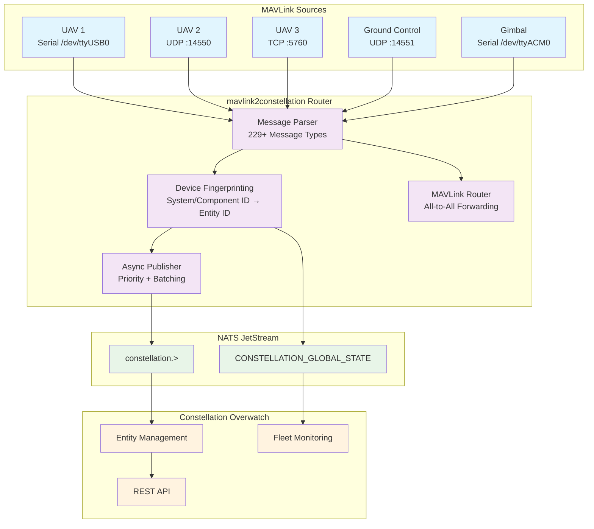

# MAVLink2Constellation - Enhanced Multi-Entity Router

<p align="center">
  
</p>

<p align="center">
  High-performance MAVLink to NATS JetStream bridge with multi-entity support for the Constellation Overwatch platform.
</p>

---

## Overview

`mavlink2constellation` is an advanced edge service that ingests MAVLink telemetry from multiple drones and robotic fleets simultaneously, providing real-time parsing and intelligent routing to the Constellation Overwatch NATS JetStream mesh. It supports multiple serial ports, UDP streams, and TCP connections with automatic device fingerprinting and hierarchical entity management.

### Key Features

* **Multi-Entity Support**: Handle 10+ concurrent drone streams with automatic entity_id resolution
* **Multiple Connection Types**: Serial (UART), UDP, TCP with extensible configuration
* **High-Performance Async Publishing**: Batched NATS publishing with priority-based routing
* **Smart Device Fingerprinting**: Automatic system_id/component_id to entity_id mapping
* **Real-time KV State Sync**: Live device state updates to CONSTELLATION_GLOBAL_STATE
* **Auto-Discovery**: Zero-config detection of serial devices and network streams
* **Performance Monitoring**: Built-in metrics and health endpoints
* **Enterprise Ready**: Graceful error handling, auto-reconnection, and monitoring

## Architecture

### Enhanced Multi-Entity Data Flow



### Entity ID Resolution Strategy

```
MAVLink Stream → Fingerprinting → Entity Assignment

Resolution Priority (from overwatch.yaml):
1. component_id match → Use entity_id from config
2. system_id match   → Use entity_id from config
3. ENTITY_MAPPINGS   → Use entity_id from env var
4. Auto-generate     → {entity_prefix}_{system_id}_{component_id}

Example (with org_id: abc123):
  system_id=1, component_id=1  → drone001 (from overwatch.yaml)
  system_id=2, component_id=1  → drone002 (from overwatch.yaml)
  system_id=3, component_id=1  → device_3_1 (auto-generated)

Published Subjects:
  constellation.telemetry.abc123.drone001
  constellation.telemetry.abc123.drone002
  constellation.telemetry.abc123.device_3_1

KV Signal Tree (per entity):
  drone001                      → Core entity metadata
  drone001.mavlink.heartbeat    → Heartbeat/mode data
  drone001.mavlink.position     → GPS/position data
  drone001.mavlink.attitude     → Attitude/orientation
  drone001.mavlink.power        → Battery/power data
  drone001.mavlink.flight       → VFR HUD flight data
```

## Quick Start

### 1. Prerequisites

```bash
# Install Go 1.21+
go version

# Start NATS with JetStream (required)
nats-server -js

# Start Constellation Overwatch (optional but recommended)
# Follow overwatch setup instructions
```

### 2. Install and Configure

```bash
# Clone repository
git clone https://github.com/Constellation-Overwatch/mavlink2constellation.git
cd mavlink2constellation

# Install dependencies
go mod download

# Create configuration files
cp .env.example .env
cp overwatch.example.yaml overwatch.yaml

# Edit configurations (see sections below)
# Build
go build -o bin/mavlink2constellation ./cmd/microlith/
```

### 3. Configure overwatch.yaml (Required)

The `overwatch.yaml` file defines your organization and entity identities. **This is required** - the bridge will not start without it.

```yaml
# overwatch.yaml - Entity Registry & Identity Configuration

organization:
  org_id: "your-org-uuid"              # Required: Get from Overwatch UI or generate UUID
  name: "My Fleet"
  org_type: "company"
  description: "My drone fleet operator"

# Map MAVLink system_id/component_id to Constellation entities
entities:
  - entity_id: "drone-001-uuid"        # UUID from Overwatch platform
    name: "drone001"                   # Human-readable name
    system_id: 1                       # MAVLink system_id (1-255)
    component_id: 1                    # MAVLink component_id (1=autopilot)

  - entity_id: "drone-002-uuid"
    name: "drone002"
    system_id: 2
    component_id: 1

  - entity_id: "gcs-uuid"
    name: "gcs001"
    system_id: 255                     # GCS typically uses 255
    component_id: 190                  # MISSIONPLANNER component

# Auto-discovered devices (not in entities list)
defaults:
  entity_prefix: "device"              # Auto-generated: device_1_1, device_2_1, etc.
  auto_register: true

routing:
  root_subject: "constellation"        # NATS subject root
```

See [overwatch.example.yaml](overwatch.example.yaml) for full documentation and all options.

### 4. Configure .env

Create `.env` with your connection settings:

```bash
# === Connection Configuration ===

# Network Discovery (Recommended for most setups)
MAVLINK_DISCOVERY_MODE=true
MAVLINK_DISCOVERY_HOST=0.0.0.0
MAVLINK_DISCOVERY_PORT=14550

# OR Serial Connection (for direct radio/USB)
# SERIAL_DEVICE=/dev/ttyUSB0
# SERIAL_BAUD=57600

# UDP Forwards (for GCS, instruments, etc.)
UDP_FORWARDS=127.0.0.1:14555

# NATS Configuration
NATS_URL=nats://localhost:4222
NATS_AUTH_TOKEN=your-token-here
NATS_STREAM_NAME=CONSTELLATION_TELEMETRY
NATS_KV_BUCKET=CONSTELLATION_GLOBAL_STATE

# Monitoring
ENABLE_METRICS=true
METRICS_PORT=9090
LOG_LEVEL=info
```

See [.env.example](.env.example) for all configuration options.

### 5. Run

```bash
# Run the bridge
./bin/mavlink2constellation

# Or run directly
go run ./cmd/microlith/main.go
```

### 6. Verify

```bash
# Watch telemetry stream
nats sub "constellation.telemetry.>"

# Watch KV state updates
nats kv watch CONSTELLATION_GLOBAL_STATE

# Get specific entity state
nats kv get CONSTELLATION_GLOBAL_STATE drone001.mavlink.heartbeat
```

## Configuration Guide

### Multi-Entity Setup Patterns

#### Pattern 1: Multiple Serial Vehicles
```bash
# Multiple UART connections with explicit entity mapping
SERIAL_DEVICES=/dev/ttyUSB0,/dev/ttyACM0
SERIAL_BAUDS=57600,115200
SERIAL_ENTITY_IDS=uav001,gimbal001
CONSTELLATION_ORG_ID=myfleet
```

#### Pattern 2: Network Discovery + Serial
```bash
# Hybrid: Serial for primary vehicle + network discovery for others
SERIAL_DEVICES=/dev/ttyUSB0
SERIAL_ENTITY_IDS=uav001
MAVLINK_DISCOVERY_MODE=true
MAVLINK_DISCOVERY_PORT=14550
UDP_FORWARDS=127.0.0.1:14551  # Forward to QGroundControl
```

#### Pattern 3: Pure Network (Recommended)
```bash
# Network-only: All vehicles connect via UDP/TCP
MAVLINK_DISCOVERY_MODE=true
MAVLINK_DISCOVERY_HOST=0.0.0.0
MAVLINK_DISCOVERY_PORT=14550
ENABLE_TCP_SERVER=true
TCP_SERVER_PORT=5760
UDP_FORWARDS=127.0.0.1:14551,192.168.1.100:14552
```

### Entity ID Assignment

The system supports multiple entity ID assignment strategies:

1. **Explicit Mapping** (Recommended for production):
```bash
ENTITY_MAPPINGS={"1":{"entity_id":"dragon001"},"2":{"entity_id":"phoenix001"}}
```

2. **Port-based Assignment**:
```bash
SERIAL_ENTITY_IDS=uav001,uav002,gimbal001  # Maps to serial device order
```

3. **Auto-generation** (Development):
```bash
# Uses pattern: {ORG_ID}.{DEFAULT_PREFIX}_{system_id}
CONSTELLATION_ORG_ID=testfleet
DEFAULT_ENTITY_PREFIX=drone
# Results: testfleet.drone_1, testfleet.drone_2, etc.
```

### Performance Configuration

For high-throughput deployments:

```bash
# Async Publishing Performance
MESSAGE_BUFFER_SIZE=2000
ASYNC_BATCH_SIZE=100
BATCH_TIMEOUT_MS=50
MAX_CONCURRENT_ENTITIES=50

# NATS Performance
NATS_MAX_MSGS=1000000
NATS_MAX_BYTES=2147483648  # 2GB
NATS_STORAGE_TYPE=file     # or 'memory' for speed

# System Limits
ROUTING_WORKERS=4
CONNECTION_POOL_SIZE=20
```

## Testing Your Setup

### 1. Verify CONSTELLATION_GLOBAL_STATE KV Publishing

```bash
# Check KV bucket exists
nats kv ls

# Watch entity state updates in real-time
nats kv watch CONSTELLATION_GLOBAL_STATE

# Check specific entity
nats kv get CONSTELLATION_GLOBAL_STATE entity.org001.uav001
```

### 2. Test Multiple Entity Streams

```bash
# Terminal 1: Run the router
./bin/mavlink2constellation-enhanced

# Terminal 2: Monitor NATS subjects
nats sub "constellation.>"

# Terminal 3: Monitor KV updates
nats kv watch CONSTELLATION_GLOBAL_STATE

# Terminal 4: Simulate multiple vehicles
./scripts/mavlink_simulator.sh 127.0.0.1 14550 1 60 100 &  # Vehicle 1
./scripts/mavlink_simulator.sh 127.0.0.1 14551 2 60 100 &  # Vehicle 2
```

### 3. Load Testing

```bash
# Run comprehensive load test
./scripts/load_test.sh

# Quick performance test
./scripts/benchmark.sh

# Full test suite
./scripts/test-suite.sh
```

## Monitoring and Operations

### Health Endpoints

```bash
# Application health
curl http://localhost:8080/health

# Detailed metrics
curl http://localhost:8080/metrics | jq

# Entity status
curl http://localhost:8080/entities | jq
```

### Log Analysis

```bash
# Real-time logs
tail -f /var/log/mavlink2constellation/app.log

# Filter by entity
grep "uav001" /var/log/mavlink2constellation/app.log

# Performance analysis
grep "Published batch" /var/log/mavlink2constellation/app.log
```

### NATS Monitoring

```bash
# Stream info
nats stream info CONSTELLATION_TELEMETRY

# Subject activity
nats stream report CONSTELLATION_TELEMETRY

# KV bucket status
nats kv status CONSTELLATION_GLOBAL_STATE
```

## Troubleshooting

### Common Issues

#### No Messages Published
1. Check NATS connection: `nats ping`
2. Verify stream exists: `nats stream ls`
3. Check device fingerprinting: Look for "waiting for HEARTBEAT" logs

#### Entity ID Not Assigned
1. Verify ENTITY_MAPPINGS JSON syntax
2. Check system_id in MAVLink messages
3. Ensure CONSTELLATION_ORG_ID is set

#### Performance Issues
1. Enable metrics: `ENABLE_METRICS=true`
2. Check batch sizes in logs
3. Monitor queue depths: `curl localhost:8080/metrics`

#### Serial Device Issues
1. Check permissions: `ls -la /dev/ttyUSB*`
2. Verify baud rate matches vehicle
3. Test with: `screen /dev/ttyUSB0 57600`

### Production Deployment

```bash
# systemd service example
sudo cp scripts/mavlink2constellation.service /etc/systemd/system/
sudo systemctl enable mavlink2constellation
sudo systemctl start mavlink2constellation

# Docker deployment
docker run -d \
  --name mavlink2constellation \
  --device /dev/ttyUSB0 \
  --network host \
  -v $(pwd)/.env:/app/.env \
  mavlink2constellation:latest
```

## Development

### Building From Source

```bash
# Build all versions
./scripts/build.sh

# Development with hot reload
go run ./cmd/enhanced/main.go

# Run tests
go test ./...

# Generate test coverage
go test -coverprofile=coverage.out ./...
go tool cover -html=coverage.out
```

### Contributing

1. Fork the repository
2. Create feature branch: `git checkout -b feature/multi-tcp-support`
3. Add tests for new functionality
4. Submit pull request with detailed description

## License

MIT License. See [LICENSE](LICENSE) for details.

---

### Support

- **Documentation**: See `/docs` folder for detailed guides
- **Issues**: Report bugs on GitHub Issues
- **Discord**: Join the Constellation Overwatch community
- **Email**: support@constellation-overwatch.com

**Production Note**: This enhanced version is actively tested with 10+ concurrent entities in production environments. Monitor resource usage and adjust batch sizes based on your specific deployment requirements.