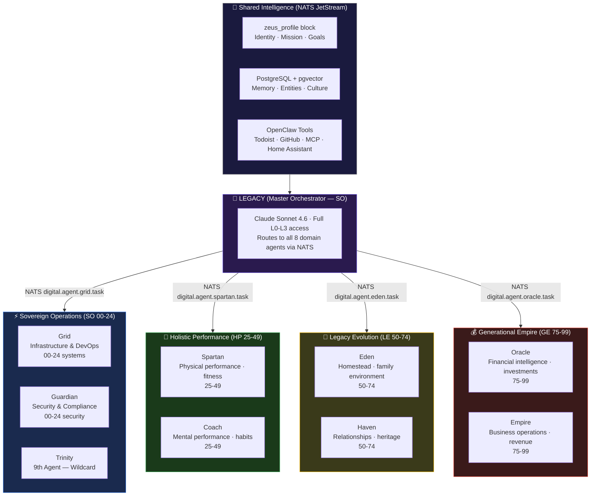
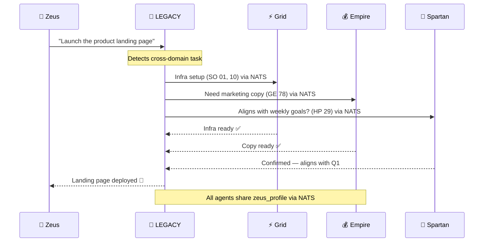

# Agent Architecture

## The Nine Agents (OpenClaw)

## Cross-Domain Task Flow

## Autonomy Levels

| Level | Name | Who Acts | Examples |
|-------|------|----------|---------|
| L3 | Full autonomy | Agent alone | Read files, route, search, respond |
| L2 | Delegated | Agent + LEGACY orchestration | Research, code, web automation |
| L1 | HITL | Zeus approves | Financial moves, external comms |
| L0 | Human only | Zeus only | Legal, health emergencies, deletions |

## Agent Roster

| Agent | Domain | Primary Tools | Autonomy |
|-------|--------|--------------|---------|
| **LEGACY** | SO (master) | All tools | L0-L3 full |
| **Grid** | SO 00-24 | SSH, Docker, GitHub, infra APIs | L2-L3 |
| **Guardian** | SO 00-24 | Security scans, audit logs | L1-L2 |
| **Trinity** | SO 00-24 | Flexible | L2-L3 |
| **Spartan** | HP 25-49 | Health APIs, calendar, fitness | L2-L3 |
| **Coach** | HP 25-49 | Habit tracker, goals | L2-L3 |
| **Oracle** | GE 75-99 | Finance APIs, market data | L1-L2 |
| **Empire** | GE 75-99 | Business tools, CRM | L1-L2 |
| **Eden** | LE 50-74 | Home Assistant, FarmBot | L2-L3 |
| **Haven** | LE 50-74 | Family calendar, heritage | L2-L3 |

---

## Related

- [[00-24 SO (Sovereign Operations)/00 Framework (Doctrine) (The Constitution)/00 Framework|00 Framework]]
