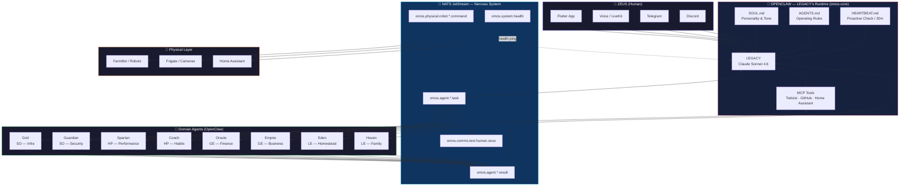

# Agent Hive Map

> The OpenClaw runtime: how Zeus reaches LEGACY, how LEGACY commands domain agents, and how everything connects through NATS JetStream.

## Key Relationships

| From | To | Via | Purpose |
|------|----|-----|---------|
| Zeus | LEGACY | Any channel | Human → AI command |
| LEGACY | Domain agents | NATS `omos.agent.*.task` | Delegate domain-specific tasks |
| Domain agents | LEGACY | NATS `omos.agent.*.result` | Return results |
| LEGACY | Physical | NATS `omos.physical.robot.*.command` | Control robots/home |
| LEGACY | Zeus | Same channel | Response / proactive nudge |

## Infrastructure

| Component | Host | Port |
|-----------|------|------|
| OpenClaw (LEGACY) | omos-core 100.123.126.34 | Gateway 11434 |
| OpenClaw (agents) | omos-sentinel 100.66.235.38 | Gateway 11434 |
| NATS JetStream | omos-core | 4222 |
| PostgreSQL memory | omos-core | 5432 |
| LiveKit voice | omos-core | 7880 |

---

## Related

- [[00-24 SO (Sovereign Operations)/00 Framework (Doctrine) (The Constitution)/00 Framework|00 Framework]]
