# Codex Domain Map

> The complete 00–99 slot structure. 100 total slots across 4 life domains, each 25 wide.

```mermaid
graph LR
    ROOT["🧠 OneMind Codex\n00–99 Slots\n100 total"]

    ROOT --> UI["00–24\n⚡ UI\nSovereign Operations\nThe Brain"]
    ROOT --> HP["25–49\n💪 HP\nHolistic Performance\nSelf Path"]
    ROOT --> LE["50–74\n🏠 LE\nLegacy Evolution\nFamily Path"]
    ROOT --> GE["75–99\n💰 GE\nGenerational Empire\nWealth Path"]

    UI --> UI0["00 Framework\nDoctrine & Philosophy"]
    UI --> UI1["01 Command\nDashboard & Navigation"]
    UI --> UI2["02 Agents\nAI, Memory & Tools"]
    UI --> UI3["06 Protocols\nSOPs"]
    UI --> UI4["04 Resources\nAssets & References"]
    UI --> UI5["06 Inbox\nCapture Queue"]
    UI --> UI6["08 Infrastructure\nGrid & APIs"]
    UI --> UI7["09 Automation\nN8N Workflows"]
    UI --> UI8["10 Development\nCode & Testing"]
    UI --> UI9["11 Security\nCyber"]
    UI --> UI10["12 Research\nR&D"]

    HP --> HP1["25 Identity\nSelf & Purpose"]
    HP --> HP2["26 Intelligence\nEducation"]
    HP --> HP3["27 Body\nHealth & Wellness"]
    HP --> HP4["28 Mastery\nSkills & Career"]
    HP --> HP5["29 Life Systems\nDaily Ops"]
    HP --> HP6["30 Finance\nPersonal Money"]
    HP --> HP7["31 Sovereignty\nLegal"]
    HP --> HP8["32 Relationships\nSocial"]
    HP --> HP9["33 Joy\nRecreation & Travel"]
    HP --> HP10["34 Spirituality\nMetaphysics"]

    LE --> LE1["50 Home\nSanctuary & Property"]
    LE --> LE2["51 Marriage\nPartnership"]
    LE --> LE3["52 Offspring\nParenting"]
    LE --> LE4["53 Parents\nElder Care"]
    LE --> LE5["54 Heritage\nHistory & Traditions"]
    LE --> LE6["55 Health\nFamily Wellness"]
    LE --> LE7["56 Wealth\nEstate & Assets"]
    LE --> LE8["57 Legal\nDocuments"]
    LE --> LE9["58 Community\nExtended Network"]

    GE --> GE1["75 Zeus Delacruz\nPersonal Brand"]
    GE --> GE2["76 Legacy Acadacom\nEducation"]
    GE --> GE3["77 Legacy Platform\nIP Holdings"]
    GE --> GE4["78 Legacy Restore\nCredit"]
    GE --> GE5["79 Technology\nTech Stack"]
    GE --> GE6["80 Treasury\nFinance"]
    GE --> GE7["81 Strategy\nAnalytics"]
    GE --> GE8["83 Partnerships\nNetwork"]
    GE --> GE9["84 Ventures\nNew Ops & Innovation"]

    style ROOT fill:#1a1a2e,stroke:#7c6af7,color:#fff
    style UI fill:#16213e,stroke:#7c6af7,color:#fff
    style HP fill:#16213e,stroke:#4ade80,color:#fff
    style LE fill:#16213e,stroke:#fb923c,color:#fff
    style GE fill:#16213e,stroke:#fbbf24,color:#fff
```

## Domain Score Tracking

| Domain | Slots | Score Label | What It Measures |
|--------|-------|-------------|-----------------|
| UI 00–24 | 25 | — | Tech infrastructure & AI coordination |
| HP 25–49 | 25 | PI Score | Personal Intelligence — self-optimization |
| LE 50–74 | 25 | LI Score | Legacy Intelligence — family & heritage |
| GE 75–99 | 25 | WI Score | Wealth Intelligence — business & revenue |

---

## Related

- [[00-24 SO (Sovereign Operations)/00 Framework (Doctrine) (The Constitution)/00 Framework|00 Framework]]
