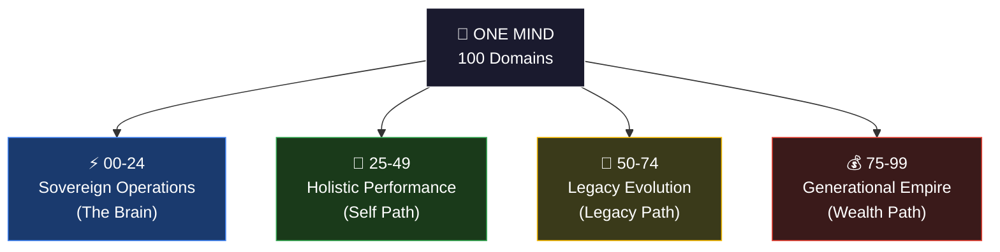
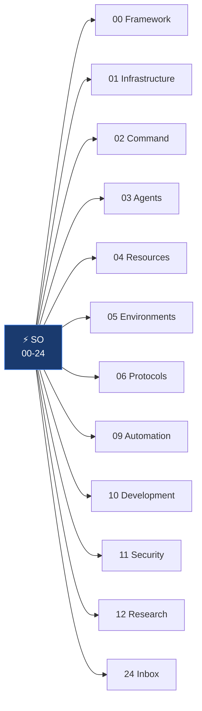
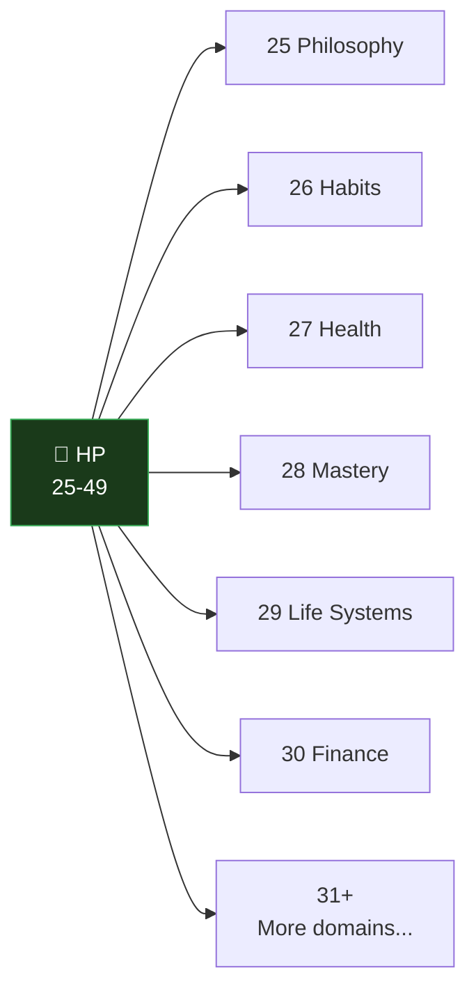
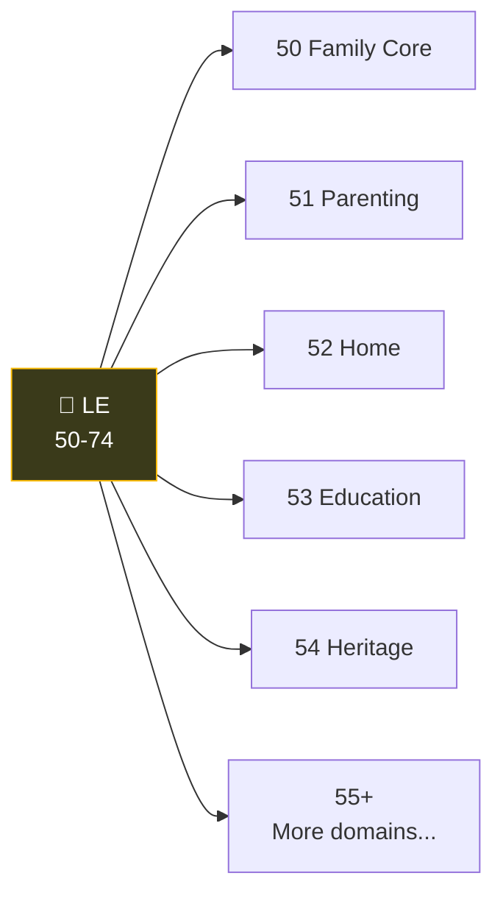
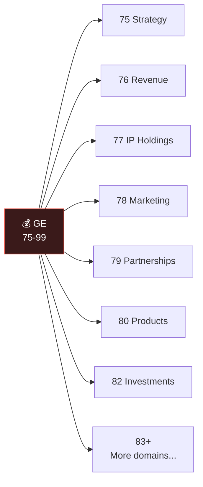

# Domain Map — 100 Domains

## The 3+1 Architecture

## SO — Sovereign Operations (The Brain)

## HP — Holistic Performance (Self Path)

## LE — Legacy Evolution (Legacy Path)

## GE — Generational Empire (Wealth Path)

## Key Insight

- **SO serves the other 3** — it's the operating system, not a life domain
- **3 life paths** cover everything: Self (HP) + Family (LE) + Wealth (GE)
- **100 slots** means you'll never run out of room — most people use 30-50 actively

---

## Related

- [[00-24 SO (Sovereign Operations)/00 Framework (Doctrine) (The Constitution)/00 Framework|00 Framework]]
