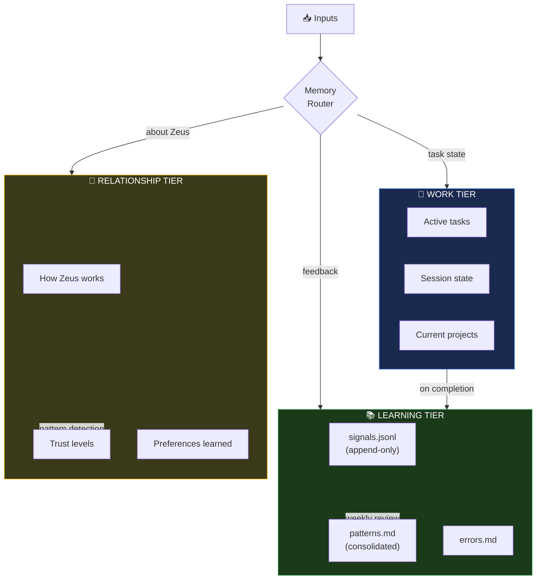
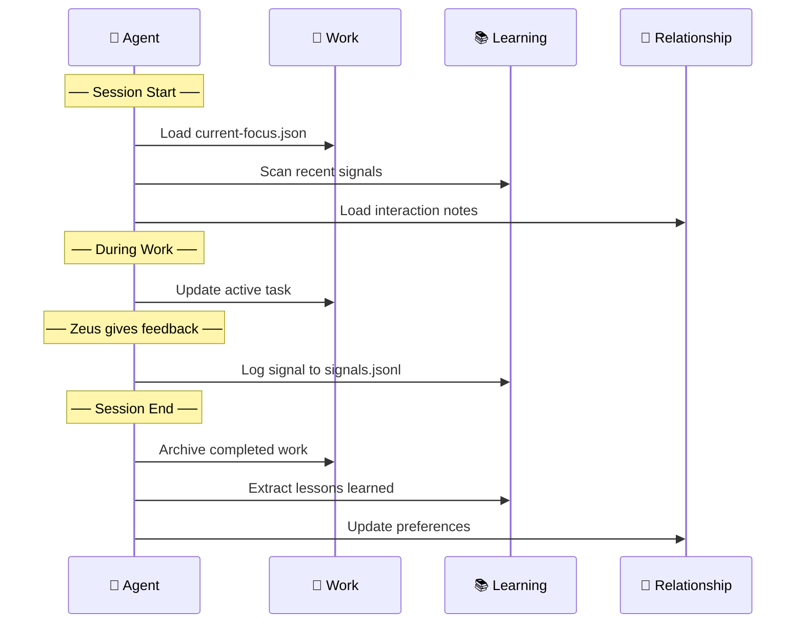

# Memory Architecture

## 3-Tier System



## Session Lifecycle



## What Each Tier Stores

| Tier | Purpose | Lifecycle | Format |
|------|---------|-----------|--------|
| **Work** | What's happening now | Created → archived | JSON |
| **Learning** | What we've learned | Append-only → consolidated weekly | JSONL + MD |
| **Relationship** | How to work with Zeus | Updated after significant interactions | Markdown |

## Location

```
_codex/memory/
├── work/
│   └── current-focus.json
├── learning/
│   ├── signals.jsonl
│   └── patterns.md
└── relationship/
    └── interaction-notes.md
```


---

## Related

- [[00-24 SO (Sovereign Operations)/00 Framework (Doctrine) (The Constitution)/00 Framework|00 Framework]]
