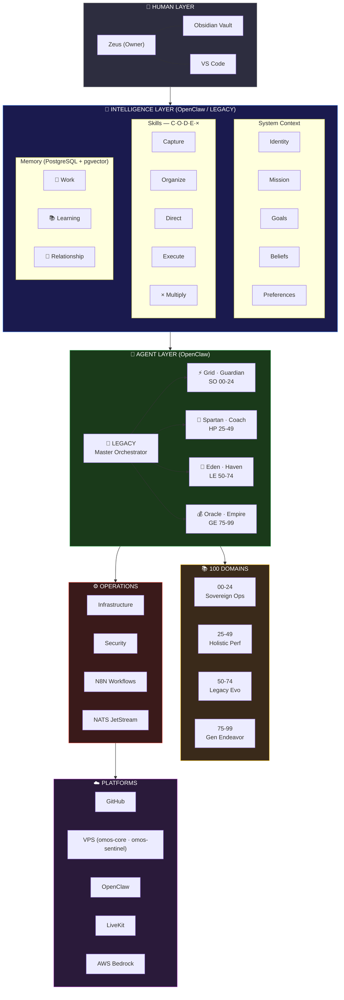

# OneMind System Architecture

## Reading Guide

**Top to Bottom = Human to Machine**

| Layer | What | Where |
|-------|------|-------|
| Human | Zeus interacts via Obsidian + VS Code | Physical |
| Intelligence | Identity, skills, memory — the AI brain | OpenClaw / LEGACY |
| Agents | LEGACY master + 8 domain agents (SO/HP/LE/GE) | omos-core + omos-sentinel |
| Knowledge | 100 domains of life documentation | Codex root folders |
| Operations | NATS events, N8N automation, config | omos-core |
| Platforms | AWS Bedrock, LiveKit, GitHub, VPS | Cloud + VPS |

---

## Related

- [[00-24 SO (Sovereign Operations)/00 Framework (Doctrine) (The Constitution)/00 Framework|00 Framework]]
