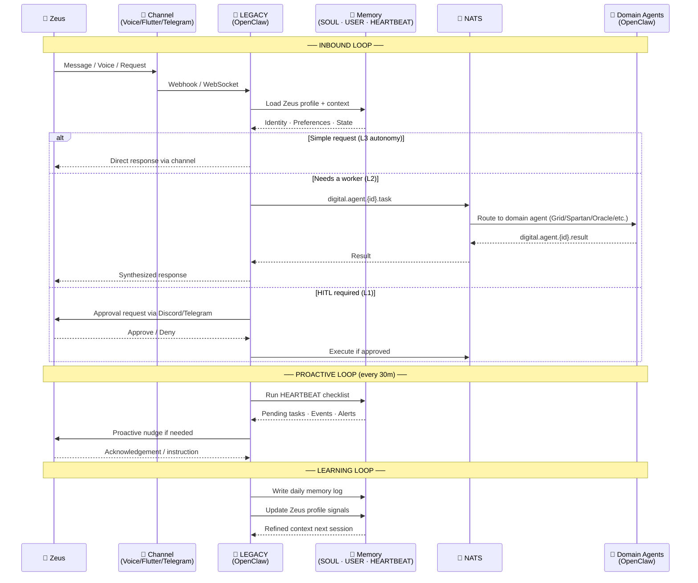

# Zeus + Legacy Loop

> The human↔AI feedback cycle: inbound requests, proactive outreach, and continuous learning across every interaction.

## Autonomy Levels

| Level | Name | Who Acts | Examples |
|-------|------|----------|---------|
| L3 | Full autonomy | Legacy alone | Read files, route, search, respond |
| L2 | Delegated | Legacy + Workers | Research, code, web automation |
| L1 | HITL | Zeus approves | Financial moves, external comms, purchases |
| L0 | Human only | Zeus only | Legal, health emergencies, deletions |

## Loop Frequencies

- **Inbound Loop** — triggered on every message/request (real-time)
- **Proactive Loop** — every 30 minutes via HEARTBEAT checklist
- **Learning Loop** — end of each day, daily memory log written

---

## Related

- [[00-24 SO (Sovereign Operations)/00 Framework (Doctrine) (The Constitution)/00 Framework|00 Framework]]
