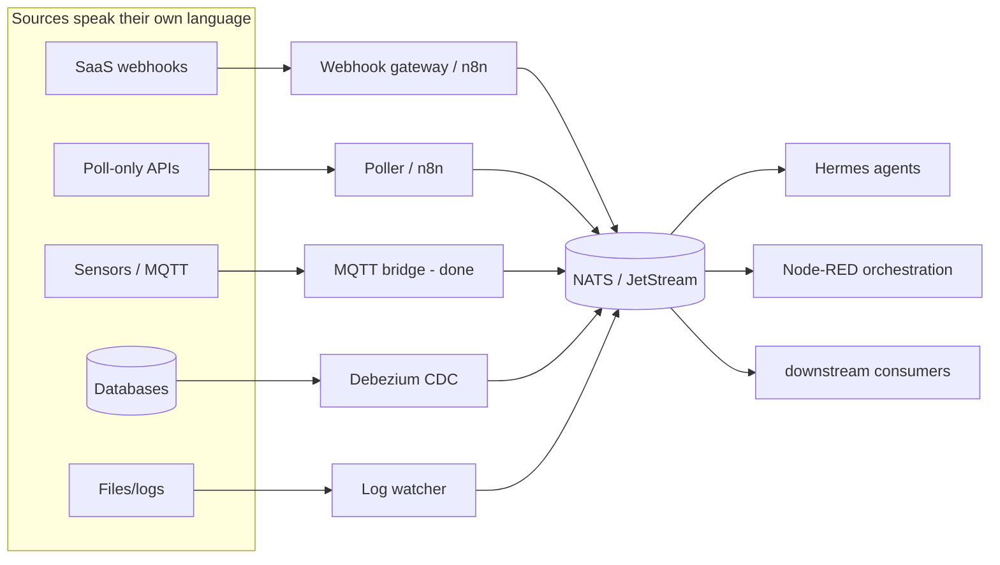

# NATS as the Universal Event Bus — Strategy

> How to make NATS the spine for everything (all SaaS, sensors, robots, agents) **without forcing any source to natively speak NATS.**
> Last updated: 2026-06-01

## The core principle

You never force a SaaS or device to "speak NATS." You **translate at the edge.** NATS becomes universal not because everything adopts it, but because one thin adapter at each boundary converts whatever the source already emits into a NATS message. The source stays dumb; the edge does the work.

```
Source speaks its native language  →  edge adapter translates once  →  NATS
(Stripe webhook, sensor MQTT,         (one adapter per PROTOCOL,        (one normalized
 Notion API, a log file)               not per app)                      envelope)
```

The mistake to avoid: "one integration per SaaS." Wrong. There are only ~5 ways anything emits an event. Build one ingress per category and you've covered every SaaS and device that will ever exist.

## The 5 ingress categories (this is the whole game)

| How the source emits | Edge adapter you build ONCE | Covers |
|---|---|---|
| **Webhooks** (push HTTP) | A webhook gateway → NATS | Stripe, GitHub, Notion, Linear, Slack, Calendly — ~90% of SaaS |
| **Poll-only API** (no webhook) | A generic poller (cron → API → diff → NATS) | Anything with only a REST API |
| **Native bus** (MQTT/Kafka/AMQP) | A protocol bridge | Sensors (DONE — MQTT :1883), IoT, other brokers |
| **Database changes** (CDC) | Debezium / logical replication → NATS | Any Postgres/MySQL app you own |
| **Files / logs** | A watcher (inotify → NATS) | Local tools, exports, drone logs |

Five adapters and **everything** funnels into NATS. You're not integrating 200 SaaS apps — you're building 5 translators.

## You already own the universal adapters

Don't hand-build most of these. Tools whose entire job is "talk to 200 SaaS, emit elsewhere":

- **n8n / Node-RED** (see [n8n-migration-plan.md](n8n-migration-plan.md); Node-RED running) — hundreds of SaaS connectors in, one "publish to NATS" node out. Solves the webhook + poller categories with no code.
- **Composio** (composio-cli skill) — auth+tool gateway to hundreds of SaaS. Use as a managed ingress for OAuth-heavy ones.
- **Webhook gateway** (see [webhook-to-nats.md](webhook-to-nats.md)) — the already-documented pattern.

The "without forcing it" answer: **let n8n / Node-RED / Composio be the universal translator.** They speak fluent SaaS so NATS doesn't have to.



## The two rules that make it actually work

The adapters are easy. Success or failure is decided by two rules every adapter must obey.

### Rule 1 — One normalized envelope (CloudEvents)

**CloudEvents** is just a standard JSON shape for "what an event looks like" — not a product, nothing to install, a CNCF open standard (same foundation as Kubernetes/NATS). It says: wrap every event in one standard outer envelope and put the vendor's original payload untouched inside `data`.

```json
{
  "specversion": "1.0",
  "id": "uuid-here",
  "source": "stripe",                         // who emitted it
  "type": "stripe.payment.succeeded",         // what happened
  "time": "2026-06-01T18:00:00Z",             // when
  "subject": "biz.stripe.payment.succeeded",  // your NATS subject
  "data": { /* the raw Stripe payload, untouched */ }
}
```

Why it matters here:
- **Agents read the envelope, never the vendor's shape.** Hermes handles an event from any source because the wrapper is identical — it looks at `type`/`source`, not Stripe's field names.
- **Swap a vendor, change nothing downstream.** Drop Stripe for another processor → only that one adapter changes; consumers still see `type: payment.succeeded`.
- **Tools already understand it.** Node-RED, n8n, most tooling have CloudEvents support — you're not inventing a format nobody speaks.

Honest "do I have to?": No — you could invent your own envelope with the same ~5 fields. The only reason to use CloudEvents is you don't have to design/defend it and other tools already speak it. Free, battle-tested default; skip the bikeshedding.

Analogy: NATS is the conveyor belt; CloudEvents is the shipping-label standard. Box contents (`data`) differ wildly, but every box has the same label format so the sorter never has to open it.

### Rule 2 — One subject taxonomy

Hierarchical subjects so consumers subscribe by wildcard:

```
<domain>.<source>.<entity>.<event>
  biz.stripe.payment.succeeded
  biz.notion.page.updated
  legacy.calendar.event.created
  rad.demo.land.soil.moisture        ← already live
  rad.<id>.robots.drone1.telemetry   ← coming next
```

Now Hermes subscribes:
- `biz.>` → business agent
- `legacy.>` → personal agent
- `rad.>` → homestead/robotics

The bus enforces the personal/business namespace isolation **for free** — the same `legacy.*` / `biz.*` split already chosen for the combined Hermes instance.

## Recommendation — what to actually stand up

1. **Don't build all 5 at once.** MQTT (sensors) and a webhook pattern already exist.
2. **Make n8n / Node-RED the webhook + poller ingress.** Point every SaaS webhook at it; add one reusable "wrap in CloudEvents → publish to NATS" sub-flow. That single sub-flow handles ~90% of all SaaS with zero per-app code.
3. **Lock the envelope + subject taxonomy now** (CloudEvents + `<domain>.<source>.<entity>.<event>`). Same schema-first discipline as the robotics twin — the contract is the asset, adapters are replaceable.
4. **Add CDC and log-watch later**, only when a specific source needs it.

Net: NATS becomes universal because **five edge adapters speak every dialect into one envelope.** You never force a single SaaS to know NATS exists.

## Related vault docs

- [webhook-to-nats.md](webhook-to-nats.md)
- [n8n-migration-plan.md](n8n-migration-plan.md)
- [nats-session-protocol-deep-structure.md](nats-session-protocol-deep-structure.md)
- [session-persistence-nats-protocol.md](session-persistence-nats-protocol.md)
- [RADS-Virtual-Homestead-Digital-Twin.md](RADS-Virtual-Homestead-Digital-Twin.md)
