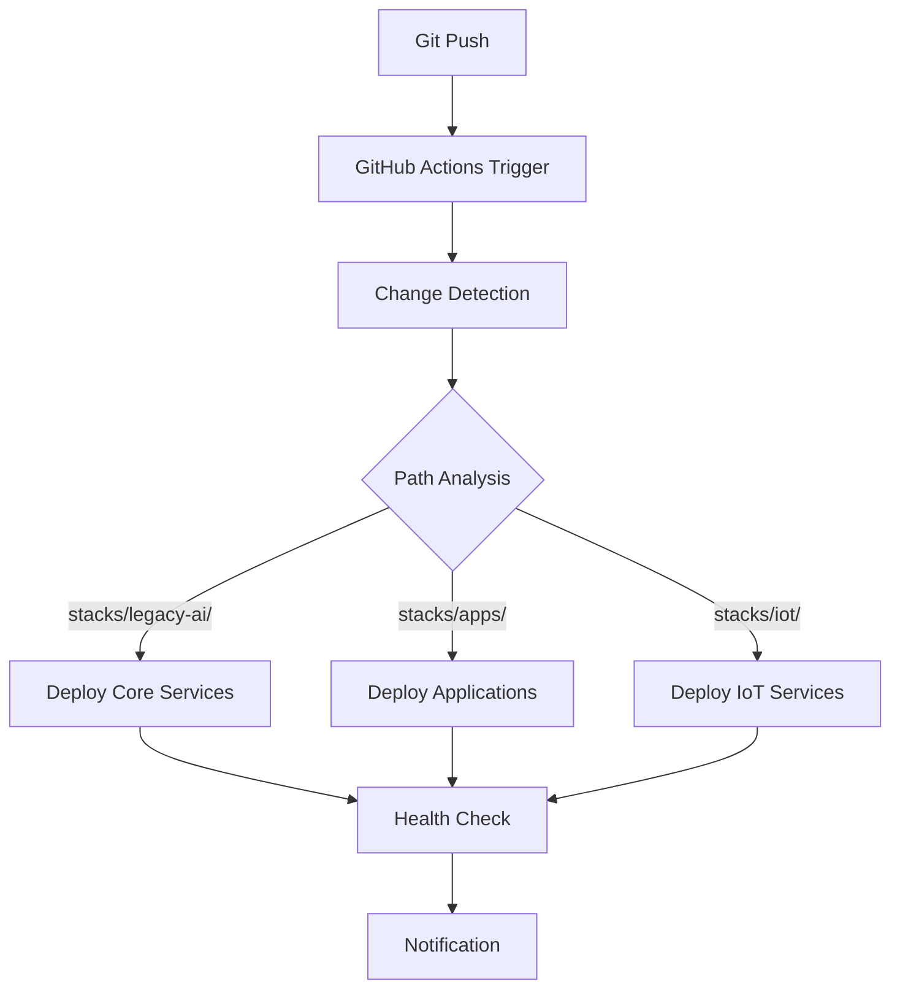

# Legacy AI Architecture

## System Overview

Legacy AI is a private hybrid cloud-edge infrastructure designed for a single user with strict privacy requirements. All services are accessible exclusively via Tailscale VPN with full GitOps automation for deployment and management.

## Design Principles

1. **Privacy First**: No public access to any services
2. **Simplicity**: Use managed services where possible
3. **Resilience**: Self-healing with health checks and restart policies
4. **Isolation**: App failures don't cascade
5. **Single Pane of Glass**: Portainer manages everything
6. **Offline Capable**: Edge devices work when disconnected
7. **GitOps Driven**: All deployments automated via GitHub Actions
8. **Immutable Infrastructure**: Infrastructure as Code with version control

## Network Architecture

### Topology

```
┌─────────────────────────────────────────────────────┐
│                  YOU (User)                         │
│            Any device with Tailscale                │
└─────────────────┬───────────────────────────────────┘
                  │
         ┌────────▼────────┐
         │   Tailscale     │
         │   VPN Mesh      │
         │  (100.x.x.x)    │
         └────────┬────────┘
                  │
      ┌───────────┴───────────┐
      │                       │
┌─────▼──────┐         ┌──────▼──────┐
│  Cloud VM  │         │ Edge Device │
│ (AWS)      │         │ (Beelink)   │
│            │         │             │
│ 100.x.x.x  │         │ 100.x.x.y   │
└────────────┘         └─────────────┘
```

### Network Layers

**Layer 1: Tailscale VPN (Access)**
- Private mesh network
- Automatic encryption
- NAT traversal
- MagicDNS for device names

**Layer 2: Caddy (Internal DNS/Proxy)**
- Subdomain routing (*.zeusops.dev)
- Reverse proxy to services
- Internal HTTPS (optional)
- Only accessible via Tailscale

**Layer 3: Docker Network (Service Communication)**
- Shared network: `legacy_network`
- Service discovery by name
- Isolated per-app networks (optional)

### DNS Strategy

**Tailscale DNS Configuration:**
```
Nameserver: 100.x.x.x (Cloud VM)
Search domain: zeusops.dev
```

**Caddy Routes:**
```
letta.zeusops.dev        → 100.x.x.x:8283
portainer.zeusops.dev    → 100.x.x.x:9443
dashboard.zeusops.dev    → 100.x.x.x:3000
ha.zeusops.dev           → 100.x.x.y:8123 (edge device)
```

**Resolution Flow:**
1. User opens `http://letta.zeusops.dev`
2. Tailscale DNS resolves to VM's Tailscale IP (100.x.x.x)
3. Caddy on VM routes to letta container
4. Response returned via Tailscale tunnel

## Component Architecture

### Cloud VM (Main Control)

**Purpose**: Central management and primary services

**Specifications**:
- Provider: AWS Lightsail
- OS: Ubuntu 22.04 LTS
- Resources: 4GB RAM, 2 vCPU, 80GB SSD
- Public IP: 3.215.29.128 (for SSH only)
- Tailscale IP: 100.x.x.x

**Services Running**:

```
Infrastructure Tier
├── Docker Engine
├── Portainer (container management)
├── Caddy (reverse proxy)
└── Tailscale (VPN)

Core Tier
├── Homepage (dashboard)
├── Monitoring (health checks)
└── Backup automation

Application Tier
├── Letta (AI agent system)
├── Supabase client
└── Future applications
```

### Edge Device (Beelink 8GB)

**Purpose**: Local services that benefit from physical proximity

**Specifications**:
- Hardware: Beelink Mini PC
- RAM: 8GB
- Storage: 256GB SSD
- Network: Ethernet + Tailscale
- Tailscale IP: 100.x.x.y

**Services Running**:

```
Agent Tier
└── Portainer Agent (managed by main Portainer)

Home Automation Tier
├── Home Assistant
├── Node-RED
├── Music Assistant
└── Farmbot (future)

Data Tier
└── Supabase offline-first client
```

**Connection to Cloud**:
- Managed via Portainer (cloud → edge)
- Services accessible via Tailscale
- Data syncs to Supabase cloud when online
- Operates independently when offline

### Future Edge Devices

**Office Device**:
- Similar setup to home
- Different services based on location needs

**Warehouse Device**:
- IoT sensors
- Farmbot control
- Local processing

## GitOps Deployment Architecture

### Overview

The Legacy AI infrastructure is managed through a comprehensive GitOps approach using GitHub Actions, providing automated deployment, rollback capabilities, and environment management.

### GitOps Components

```
┌─────────────────────────────────────────────────────┐
│                GitHub Repository                    │
│  ┌─────────────────────────────────────────────────┐│
│  │           .github/workflows/              ░░░░░░││
│  │  ┌─────────────────────────────────────────────┐││
│  │  │ deploy-production.yml    (Automated)    ░░░░│││
│  │  │ manual-control.yml       (On-demand)    ░░░░│││  
│  │  │ rollback.yml             (Emergency)    ░░░░│││
│  │  │ environment.yml          (Maintenance)  ░░░░│││
│  │  └─────────────────────────────────────────────┘││
│  └─────────────────────────────────────────────────┘│
└─────────────────┬───────────────────────────────────┘
                  │ SSH over Internet
                  ▼
┌─────────────────────────────────────────────────────┐
│              Production VM (3.215.29.128)          │
│  ┌─────────────────────────────────────────────────┐│
│  │         Docker Compose Stack                   ││
│  │  ┌─────────────────────────────────────────────┐││
│  │  │ stacks/legacy-ai/       (Core Services)     │││
│  │  │ stacks/apps/            (Applications)      │││
│  │  │ stacks/iot/             (IoT Services)      │││
│  │  └─────────────────────────────────────────────┘││
│  └─────────────────────────────────────────────────┘│
└─────────────────────────────────────────────────────┘
```

### Deployment Pipeline

**1. Automated Deployment Flow**


**2. Change Detection Strategy**
- **Path-based triggering**: Only affected services are redeployed
- **Service dependencies**: Core services deployed first
- **Incremental updates**: Minimal downtime approach

**3. Service Categories**
```yaml
Core Services (Priority 1):
  - stacks/legacy-ai/     # Letta, Memory, LLM services
  
Automation Services (Priority 2):  
  - stacks/apps/n8n-queue-mode/    # n8n workflow automation
  - stacks/apps/dify/               # Dify AI platform

IoT Services (Priority 3):
  - stacks/iot/home-assistant/      # Home automation
  - stacks/iot/node-red/            # IoT orchestration  
  - stacks/iot/emqx/                # MQTT broker

Infrastructure (Priority 4):
  - scripts/                        # System scripts
  - .github/workflows/              # Workflow updates
```

### Rollback Architecture

**Emergency Rollback Process**
1. **Pre-rollback Backup**: Automatic backup of current state
2. **Git Rollback**: Repository reset to target commit
3. **Service Restart**: All services restarted with rolled-back configuration
4. **Health Verification**: Post-rollback health checks
5. **Notification**: Status reporting via webhooks

**Rollback Safety Measures**
- Confirmation required ("CONFIRM" typed by operator)
- Pre-rollback backups stored in `/opt/backups/pre-rollback-*`
- Docker volume preservation
- Automatic service health verification

### Environment Management

**Backup Strategy**
```
/opt/backups/
├── full-backup-YYYYMMDD-HHMMSS/
│   ├── repository/              # Complete repository backup
│   ├── docker-volumes.tar.gz    # All Docker volumes
│   ├── databases/               # Database dumps
│   ├── system/                  # System configurations
│   └── MANIFEST.txt             # Backup manifest
└── config-backup-YYYYMMDD-HHMMSS/
    ├── docker-compose*.yml      # Configuration files only
    ├── app-configs/             # Application settings
    └── CONFIG-MANIFEST.txt      # Config manifest
```

**Maintenance Operations**
- System cleanup (Docker pruning, log rotation, temp file cleanup)
- Resource monitoring and reporting
- Maintenance mode toggle
- Security scanning (planned)

### Monitoring & Alerting

**Health Check Endpoints**
```yaml
Services Monitored:
  - letta:            http://localhost:8283
  - n8n-main:         http://localhost:5678  
  - dify-web:         http://localhost:3000
  - home-assistant:   http://localhost:8123
  - node-red:         http://localhost:1880
```

**Notification Webhooks**
- **Deployment Status**: `POST http://localhost:5678/webhook/deployment-status`
- **Rollback Alerts**: `POST http://localhost:5678/webhook/rollback-notification`  
- **Health Alerts**: `POST http://localhost:5678/webhook/health-alerts`

### GitOps Security

**Access Control**
- GitHub Secrets for sensitive data (`VM_PRIVATE_KEY`, `PORTAINER_TOKEN`)
- SSH key-based authentication to VM
- Workflow execution permissions restricted
- Audit logging via GitHub Actions logs

**Network Security**  
- SSH connections over internet (port 22)
- All service access via Tailscale VPN only
- No public exposure of application services
- Encrypted communication channels

### Future GitOps Enhancements

**Phase 2 Roadmap**
- Blue-green deployments for zero-downtime updates
- Canary releases with automated rollback triggers
- Multi-environment support (staging/production pipelines)  
- Prometheus/Grafana monitoring integration
- Automated security scanning and compliance checks

---

## Data Architecture

### Database Strategy

**Single Source of Truth: Supabase Cloud**

```
┌──────────────────┐
│  Supabase Cloud  │
│   (Hosted)       │
└────────┬─────────┘
         │
    ┌────┴────┐
    │         │
┌───▼───┐ ┌──▼────┐
│ Cloud │ │ Edge  │
│ Apps  │ │ Devices│
└───────┘ └───────┘
```

**Why Single Instance?**
- Simpler architecture
- No sync conflicts
- Supabase handles scaling
- Offline-first client libraries

**Edge Offline Strategy**:
1. Edge devices use Supabase JS client
2. Changes stored locally when offline
3. Automatic sync when connection restored
4. Conflict resolution by Supabase

### Data Flow Example

**Normal Operation (Online)**:
```
Home Assistant (edge)
    ↓
Supabase client (local)
    ↓ (via Tailscale)
Supabase cloud
    ↓
Letta (cloud) reads data
```

**Offline Operation**:
```
Home Assistant (edge)
    ↓
Supabase client (local) → IndexedDB cache
    ↓ (queue changes)
[Connection Lost]
...
[Connection Restored]
    ↓
Sync to Supabase cloud
```

## Application Isolation Strategy

### Problem
If one app crashes, it shouldn't affect others or infrastructure.

### Solution: Three-Tier Isolation

**Tier 1: File Isolation**
```
/opt/legacy-ai/stacks/
├── infrastructure/     # Critical services
│   ├── portainer/      # Separate directory
│   └── caddy/          # Separate directory
├── core/               # Essential services
│   ├── dashboard/      # Separate directory
│   └── monitoring/     # Separate directory
└── apps/               # User applications
    ├── letta/          # Separate directory
    └── app2/           # Separate directory
```

Each has own `docker-compose.yml` - no shared files.

**Tier 2: Docker Isolation**
```yaml
# Each app defines:
deploy:
  resources:
    limits:
      cpus: '1.0'         # Can't hog CPU
      memory: 2G          # Can't consume all RAM
    reservations:
      cpus: '0.25'        # Guaranteed minimum
      memory: 512M
```

**Tier 3: Network Isolation**
```yaml
# Shared network for inter-service communication
networks:
  legacy_network:
    external: true

# Optional: app-specific internal network
networks:
  letta_internal:
    driver: bridge
    internal: true  # No external access
```

**Tier 4: Health-Based Isolation**
```yaml
healthcheck:
  test: ["CMD", "curl", "-f", "http://localhost:8283/health"]
  interval: 30s
  timeout: 10s
  retries: 3
  start_period: 40s

restart: unless-stopped  # Auto-restart if unhealthy
```

### Failure Scenarios

**Scenario 1: Letta crashes**
- Docker restarts Letta automatically
- Other apps unaffected
- Portainer shows status change
- Logs available for debugging

**Scenario 2: Letta consumes too much memory**
- Docker enforces 2GB limit
- Letta OOM killed
- Auto-restarts
- Other apps have guaranteed resources

**Scenario 3: Edge device loses connectivity**
- Local services continue running
- Supabase client queues changes
- Sync when connection restored
- No data loss

## Security Architecture

### Access Control

**Primary: Tailscale VPN**
```
┌─────────────┐
│   Public    │
│  Internet   │
└──────┬──────┘
       │
       ✗ (blocked)
       │
┌──────▼──────────┐
│   Firewall      │
│  Only port 22   │ (SSH emergency access)
│  Only port 41641│ (Tailscale)
└──────┬──────────┘
       │
┌──────▼──────────┐
│   Tailscale     │
│   100.x.x.x     │
└──────┬──────────┘
       │
   ┌───┴───┐
   │       │
  VM    Edge
```

**No Public Access**:
- No ports exposed except SSH (emergency)
- No public DNS pointing to services
- Caddy only listens on Tailscale interface
- Portainer only accessible via Tailscale

### Authentication Layers

**Layer 1: Network (Tailscale)**
- Must be on VPN to reach services
- Device authentication required
- Per-device access control (via ACLs)

**Layer 2: Application**
- Each app has own authentication
- Portainer: Username/password
- Home Assistant: Username/password
- Letta: API key or auth token

### Emergency Access

**Scenario**: At friend's house, no Tailscale device available

**Option 1**: Install Tailscale temporarily
```bash
# On friend's device
curl -fsSL https://tailscale.com/install.sh | sh
sudo tailscale up
# Access services
# When done:
sudo tailscale logout
```

**Option 2**: AWS Lightsail console
- Browser-based SSH
- Emergency access to VM
- Can restart services
- Limited functionality

**Never**: Temporary public exposure (too risky)

## Monitoring & Observability

### Health Checks

Every container implements health checks:

```yaml
healthcheck:
  test: ["CMD", "curl", "-f", "http://localhost:[port]/health"]
  interval: 30s      # Check every 30s
  timeout: 10s       # Wait 10s for response
  retries: 3         # Mark unhealthy after 3 failures
  start_period: 40s  # Grace period during startup
```

### Monitoring Stack

**Current (Basic)**:
- Docker health checks
- Portainer container list
- Manual log inspection

**Future (Enhanced)**:
```
Prometheus (metrics)
    ↓
Grafana (visualization)
    ↓
Alerting (Slack/email)
```

### Log Aggregation

**Current**:
```bash
docker logs [container] --tail 100 --follow
```

**Future**: Centralized logging with Loki

## Backup Strategy

### What to Backup

**Critical**:
- Portainer configuration (JSON export)
- Docker volumes (application data)
- Caddy configuration
- Environment variables (.env files)

**Nice to Have**:
- Docker images (can be re-pulled)
- System configuration (can be rebuilt)

### Backup Workflow

**Daily Automated**:
```bash
# /opt/legacy-ai/scripts/backup.sh
1. Export Portainer config → Git
2. Tar critical volumes → S3
3. Copy Caddyfile → Git
4. Commit to Git with timestamp
```

**Weekly Manual**:
1. AWS Lightsail snapshot (VM image)
2. Test restore procedure

**Retention**:
- Daily backups: Keep 7 days
- Weekly backups: Keep 4 weeks
- Monthly backups: Keep 12 months

## Scaling Considerations

### Vertical Scaling (Single VM)

**Current**: 4GB RAM, 2 vCPU
**Next tier**: 8GB RAM, 4 vCPU (if needed)

**When to scale**:
- Memory usage >80% consistently
- CPU usage >70% sustained
- Slow response times

### Horizontal Scaling (Multiple Edge Devices)

**Current**: 1 edge device (Beelink)
**Future**: N edge devices (home, office, warehouse)

**Pattern**:
1. Install Portainer Agent on new device
2. Connect via Tailscale IP
3. Deploy location-specific stacks
4. All managed from central Portainer

### Application Scaling

**Current**: Single container per service
**Future**: Multiple replicas (if needed)

**Docker Swarm** (if needed):
```yaml
deploy:
  replicas: 3
  update_config:
    parallelism: 1
    delay: 10s
```

**But**: Likely unnecessary for personal use

## Technology Decisions

### Why These Choices?

**Portainer vs Kubernetes**:
- ✅ Portainer: Simple, lightweight, UI-driven
- ❌ Kubernetes: Overkill, complex, steep learning curve

**Portainer vs Dokploy**:
- ✅ Portainer: Multi-site, agent-based, established
- ❌ Dokploy: Single-server focus, newer, less mature

**Tailscale vs Wireguard**:
- ✅ Tailscale: Zero-config, NAT traversal, MagicDNS
- ❌ Wireguard: Manual setup, port forwarding required

**Single Supabase vs Distributed**:
- ✅ Single: Simple, reliable, managed
- ❌ Distributed: Complex sync, conflict resolution, maintenance

**Caddy vs Nginx/Traefik**:
- ✅ Caddy: Simple config, auto HTTPS, modern
- ❌ Nginx: Complex config
- ❌ Traefik: Kubernetes-focused

### Trade-offs Made

**Simplicity over Performance**:
- Single VM can handle workload
- Easier to maintain
- Can scale later if needed

**Managed over Self-hosted**:
- Supabase cloud vs self-hosted PostgreSQL
- Less maintenance
- Better reliability

**Privacy over Convenience**:
- Tailscale required for access
- No public-facing services
- Harder access from random devices
- But: Maximum privacy

## Future Architecture Evolution

### Phase 2: Enhanced Monitoring
```
Add: Prometheus + Grafana
Why: Better visibility into system health
When: After 5+ apps deployed
```

### Phase 3: CI/CD Integration
```
Add: GitHub Actions → Auto-deploy to Portainer
Why: Faster deployments
When: Frequent app updates
```

### Phase 4: Advanced AI Features
```
Add: GPU support, model hosting
Why: Local AI inference
When: Privacy-sensitive AI workloads
```

### Phase 5: Multi-Region
```
Add: Second VM in different region
Why: Redundancy, lower latency
When: Critical workloads require HA
```

## Disaster Recovery

### Recovery Time Objectives

- **Infrastructure**: 30 minutes (run bootstrap script)
- **Applications**: 15 minutes (Portainer restore + Git pull)
- **Data**: 0 minutes (Supabase cloud unaffected)

### Recovery Procedure

1. **Provision new VM** (if old VM dead)
2. **Run bootstrap script** (Docker, Portainer, Tailscale)
3. **Restore Portainer config** (from backup JSON)
4. **Git pull stacks** (from repository)
5. **Deploy stacks** (via Portainer)
6. **Verify health** (check all services)

**RTO**: 1 hour (worst case)
**RPO**: 24 hours (last backup)

---

**Last Updated**: January 20, 2025
