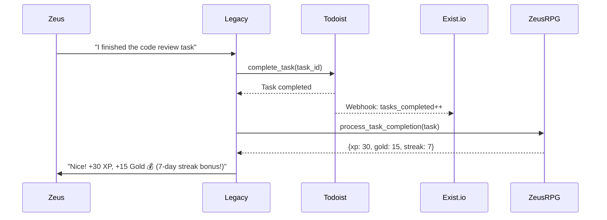

# Todoist + Exist.io Integration Deep Dive

> **Status:** Active Research  
> **Created:** 2026-01-21  
> **Decision:** Primary Task + Health Correlation Stack  
> **Cost:** $84/year (Exist.io) + Already using Todoist  

---

## Executive Summary

This document provides a comprehensive deep dive into the Todoist and Exist.io APIs for Legacy AI integration. This stack was chosen over Habitica due to:

1. **Already Using Todoist** - 116+ tasks, established workflow
2. **Native Integration** - Exist.io has built-in Todoist sync
3. **One Task System** - No cognitive overhead of two systems
4. **Correlations Engine** - Habitica can't provide this intelligence
5. **Custom Gamification** - Build ZeusRPG in Legacy instead

---

## Architecture Overview

```
┌─────────────────────────────────────────────────────────────────┐
│                        ONEMIND-OS                               │
├─────────────────────────────────────────────────────────────────┤
│                                                                 │
│   ┌───────────┐         ┌───────────┐         ┌───────────┐   │
│   │  LINEAR   │         │  Legacy   │         │  TODOIST  │   │
│   │(Dev Tasks)│◄───────►│(AI Agent) │◄───────►│(Life Tasks)│  │
│   └───────────┘         └─────┬─────┘         └───────────┘   │
│                               │                      │         │
│                               ▼                      │         │
│                        ┌───────────┐                │         │
│                        │ EXIST.IO  │◄───────────────┘         │
│                        │(Analytics)│   Native Sync            │
│                        └─────┬─────┘                          │
│                               │                                │
│                               ▼                                │
│                        ┌───────────┐                          │
│                        │ ZeusRPG   │                          │
│                        │(Custom    │                          │
│                        │Gamification)                         │
│                        └───────────┘                          │
│                                                                 │
└─────────────────────────────────────────────────────────────────┘
```

---

## Part 1: Todoist API Deep Dive

### API Overview

Todoist offers two APIs:
- **REST API v2** - Simple CRUD operations (DEPRECATED, use v1)
- **Sync API v9** - Efficient sync with batching and incremental updates
- **NEW: Todoist API v1** - Unified API (recommended)

**Base URLs:**
- REST: `https://api.todoist.com/rest/v2/`
- Sync: `https://api.todoist.com/sync/v9/`
- NEW: `https://api.todoist.com/api/v1/`

### Authentication

```python
import requests

# Using Bearer token (get from Todoist Settings > Integrations > API token)
headers = {
    "Authorization": "Bearer YOUR_API_TOKEN",
    "Content-Type": "application/json"
}
```

### Core Objects

#### Task Object
```json
{
    "id": "2995104339",
    "content": "Buy Milk",
    "description": "Get organic whole milk",
    "project_id": "2203306141",
    "section_id": "7025",
    "parent_id": null,
    "order": 1,
    "priority": 4,
    "labels": ["shopping", "health"],
    "due": {
        "date": "2026-01-22",
        "is_recurring": false,
        "datetime": "2026-01-22T10:00:00.000000Z",
        "string": "tomorrow at 10am",
        "timezone": "America/New_York"
    },
    "deadline": {
        "date": "2026-01-25"
    },
    "duration": {
        "amount": 30,
        "unit": "minute"
    },
    "is_completed": false,
    "created_at": "2026-01-21T22:36:50.000000Z",
    "creator_id": "2671355",
    "assignee_id": null,
    "url": "https://app.todoist.com/showTask?id=2995104339"
}
```

#### Project Object
```json
{
    "id": "2203306141",
    "name": "Shopping List",
    "color": "charcoal",
    "parent_id": null,
    "order": 1,
    "comment_count": 10,
    "is_shared": false,
    "is_favorite": false,
    "is_inbox_project": false,
    "is_team_inbox": false,
    "view_style": "list",
    "url": "https://app.todoist.com/showProject?id=2203306141"
}
```

### REST API Endpoints

#### Tasks

```python
# Get all active tasks
GET /rest/v2/tasks

# Get tasks by filter
GET /rest/v2/tasks?filter=today

# Get tasks by project
GET /rest/v2/tasks?project_id=2203306141

# Get tasks by label
GET /rest/v2/tasks?label=shopping

# Create a task
POST /rest/v2/tasks
{
    "content": "Complete quarterly review",
    "project_id": "2203306141",
    "due_string": "tomorrow at 2pm",
    "priority": 4,
    "labels": ["work", "important"]
}

# Update a task
POST /rest/v2/tasks/{task_id}
{
    "content": "Updated task name",
    "priority": 2
}

# Complete a task
POST /rest/v2/tasks/{task_id}/close

# Reopen a task
POST /rest/v2/tasks/{task_id}/reopen

# Delete a task
DELETE /rest/v2/tasks/{task_id}
```

#### Projects

```python
# List all projects
GET /rest/v2/projects

# Get a project
GET /rest/v2/projects/{project_id}

# Create a project
POST /rest/v2/projects
{
    "name": "New Project",
    "color": "blue",
    "is_favorite": true,
    "view_style": "board"
}

# Update a project
POST /rest/v2/projects/{project_id}

# Delete a project
DELETE /rest/v2/projects/{project_id}
```

#### Labels

```python
# Get all labels
GET /rest/v2/labels

# Create a label
POST /rest/v2/labels
{
    "name": "urgent",
    "color": "red"
}

# Update a label
POST /rest/v2/labels/{label_id}

# Delete a label
DELETE /rest/v2/labels/{label_id}
```

### Sync API (Recommended for Efficiency)

The Sync API is designed for efficient data synchronization:

```python
import requests
import json

def sync_todoist(token, sync_token="*", resource_types=["all"]):
    """
    Perform a sync with Todoist.
    
    Args:
        token: API token
        sync_token: "*" for full sync, or previous sync_token for incremental
        resource_types: List of resources to sync
        
    Returns:
        Full response with all requested data
    """
    response = requests.post(
        "https://api.todoist.com/sync/v9/sync",
        headers={"Authorization": f"Bearer {token}"},
        data={
            "sync_token": sync_token,
            "resource_types": json.dumps(resource_types)
        }
    )
    return response.json()

# Full sync to get everything
data = sync_todoist(token, "*", ["all"])
# Returns: projects, items, labels, filters, sections, etc.

# Incremental sync (only changes since last sync)
data = sync_todoist(token, data["sync_token"], ["items"])
```

#### Batch Commands

```python
# Execute multiple operations in one request
commands = [
    {
        "type": "item_add",
        "temp_id": "temp-1",
        "uuid": "unique-uuid-1",
        "args": {
            "content": "Task 1",
            "project_id": "2203306141"
        }
    },
    {
        "type": "item_add",
        "temp_id": "temp-2",
        "uuid": "unique-uuid-2",
        "args": {
            "content": "Task 2",
            "project_id": "2203306141"
        }
    },
    {
        "type": "item_complete",
        "uuid": "unique-uuid-3",
        "args": {
            "id": "existing-task-id"
        }
    }
]

response = requests.post(
    "https://api.todoist.com/sync/v9/sync",
    headers={"Authorization": f"Bearer {token}"},
    data={
        "commands": json.dumps(commands)
    }
)
```

### Webhooks

Todoist supports webhooks for real-time events:

```python
# Webhook events available:
# - item:added, item:updated, item:deleted, item:completed, item:uncompleted
# - note:added, note:updated, note:deleted
# - project:added, project:updated, project:deleted, project:archived
# - reminder:fired

# Webhook payload example:
{
    "event_name": "item:completed",
    "user_id": "2671355",
    "event_data": {
        "id": "2995104339",
        "content": "Buy Milk",
        "project_id": "2203306141",
        "priority": 1,
        "due": null,
        "labels": ["shopping"],
        "checked": true
    },
    "triggered_at": "2026-01-21T10:39:38.000000Z"
}
```

### Python SDK

```python
from todoist_api_python import TodoistAPI

api = TodoistAPI("YOUR_API_TOKEN")

# Get all tasks
tasks = api.get_tasks()

# Add a task
task = api.add_task(
    content="Buy groceries",
    due_string="today",
    priority=4
)

# Complete a task
api.close_task(task.id)

# Get projects
projects = api.get_projects()
```

### Rate Limits

- **1000 requests per 15 minutes per user**
- **1 MiB request body limit**
- **15 second processing timeout**
- **65 KiB header size limit**

---

## Part 2: Exist.io API Deep Dive

### API Overview

Exist.io provides a comprehensive API for:
- Reading tracked attributes (steps, sleep, mood, etc.)
- Writing custom data
- Accessing correlations
- Creating custom attributes

**Base URL:** `https://exist.io/api/2/`

### Authentication

Exist.io supports two auth methods:

#### 1. Simple Token (Read-Only)
```python
# Get token from https://exist.io/account/apps/
headers = {
    "Authorization": "Bearer YOUR_TOKEN"
}
```

#### 2. OAuth2 (Read/Write)
```python
# OAuth2 flow for write access
# 1. Create app at https://exist.io/account/apps/
# 2. Redirect user to authorize
# 3. Exchange code for token

# Scopes available:
# - read (all read access)
# - read_groups:activity,mood,health (specific group read)
# - write (all write access)
# - write_groups:custom (specific group write)
```

### Core Objects

#### Attribute Template
```json
{
    "name": "steps",
    "label": "Steps",
    "group": {
        "name": "activity",
        "label": "Activity",
        "priority": 1
    },
    "priority": 1,
    "value_type": 0,
    "value_type_description": "Integer"
}
```

#### Attribute Value Types
| Type | Description | Example |
|------|-------------|---------|
| 0 | Integer | 10000 (steps) |
| 1 | Float | 7.5 (hours) |
| 2 | String | "meditation, yoga" |
| 3 | Period (minutes) | 45 (workout mins) |
| 4 | Time of day | "22:30" |
| 5 | Scale (1-9) | 7 (mood rating) |

#### Correlation Object
```json
{
    "date": "2026-01-21",
    "period": 309,
    "offset": 0,
    "attribute": "sleep",
    "attribute2": "tasks_completed",
    "value": 0.45,
    "p": 0.001,
    "percentage": 45.0,
    "stars": 5,
    "second_person": "you complete more tasks when you get more sleep.",
    "strength_description": "Often go together",
    "stars_description": "Certain to be related"
}
```

### API Endpoints

#### Reading Attributes

```python
# Get all attribute templates
GET /api/2/attributes/templates/

# Get user's attributes (without values)
GET /api/2/attributes/

# Get attributes with values
GET /api/2/attributes/with-values/?days=7&groups=activity,mood

# Get specific attribute values
GET /api/2/attributes/values/?attribute=steps&limit=30
```

#### Reading Correlations

```python
# Get all correlations
GET /api/2/correlations/

# Get strong correlations only
GET /api/2/correlations/?strong=1&confident=1

# Get correlations for specific attribute
GET /api/2/correlations/?attribute=sleep

# Find specific correlation pair
GET /api/2/correlations/combo/?attribute=sleep&attribute2=tasks_completed
```

#### Reading Insights

```python
# Get insights (AI-generated observations)
GET /api/2/insights/
```

#### Reading Averages

```python
# Get attribute averages
GET /api/2/averages/?attribute=steps
```

#### Writing Data

```python
# Step 1: Acquire attribute ownership (once)
POST /api/2/attributes/acquire/
[
    {"name": "mood"},
    {"name": "mood_note"}
]

# Step 2: Update values
POST /api/2/attributes/update/
[
    {"name": "mood", "date": "2026-01-21", "value": 8},
    {"name": "mood_note", "date": "2026-01-21", "value": "Productive day!"}
]

# Increment values (for counters)
POST /api/2/attributes/increment/
[
    {"name": "steps", "date": "2026-01-21", "value": 500}
]
```

#### Creating Custom Attributes

```python
# Create new custom attribute
POST /api/2/attributes/create/
[
    {
        "name": "legacy_interactions",
        "label": "Legacy Interactions",
        "group": "custom",
        "value_type": 0
    }
]
```

### Python Client Example

```python
import requests
from datetime import datetime, timedelta

class ExistClient:
    """Exist.io API Client for Legacy integration."""
    
    def __init__(self, token: str):
        self.token = token
        self.base_url = "https://exist.io/api/2"
        self.headers = {
            "Authorization": f"Bearer {token}",
            "Content-Type": "application/json"
        }
    
    def get_attributes_with_values(
        self, 
        days: int = 7, 
        groups: list = None,
        attributes: list = None
    ) -> dict:
        """Get attribute data with recent values."""
        params = {"days": days}
        if groups:
            params["groups"] = ",".join(groups)
        if attributes:
            params["attributes"] = ",".join(attributes)
            
        response = requests.get(
            f"{self.base_url}/attributes/with-values/",
            headers=self.headers,
            params=params
        )
        return response.json()
    
    def get_correlations(
        self, 
        strong: bool = True,
        confident: bool = True,
        attribute: str = None
    ) -> dict:
        """Get correlations between tracked attributes."""
        params = {}
        if strong:
            params["strong"] = 1
        if confident:
            params["confident"] = 1
        if attribute:
            params["attribute"] = attribute
            
        response = requests.get(
            f"{self.base_url}/correlations/",
            headers=self.headers,
            params=params
        )
        return response.json()
    
    def get_specific_correlation(
        self, 
        attr1: str, 
        attr2: str
    ) -> dict:
        """Find correlation between two specific attributes."""
        response = requests.get(
            f"{self.base_url}/correlations/combo/",
            headers=self.headers,
            params={"attribute": attr1, "attribute2": attr2}
        )
        return response.json()
    
    def update_values(self, updates: list) -> dict:
        """
        Update attribute values.
        
        Args:
            updates: List of {"name": str, "date": str, "value": any}
        """
        response = requests.post(
            f"{self.base_url}/attributes/update/",
            headers=self.headers,
            json=updates
        )
        return response.json()
    
    def get_insights(self) -> dict:
        """Get AI-generated insights."""
        response = requests.get(
            f"{self.base_url}/insights/",
            headers=self.headers
        )
        return response.json()

# Usage
client = ExistClient("your_token")

# Get last 7 days of activity and mood data
data = client.get_attributes_with_values(
    days=7, 
    groups=["activity", "mood"]
)

# Find if sleep affects task completion
correlation = client.get_specific_correlation("sleep", "tasks_completed")
print(f"Correlation: {correlation['percentage']}%")
print(f"Insight: {correlation['second_person']}")
```

### Native Todoist Integration

Exist.io has **built-in Todoist integration**:

1. **Connect:** Settings > Integrations > Todoist
2. **Auto-Synced Attributes:**
   - `tasks_completed` - Daily task completions
   - `tasks_completed_p1` - Priority 1 tasks completed
   - `tasks_completed_p2` - Priority 2 tasks completed
   - `tasks_completed_p3` - Priority 3 tasks completed
   - `tasks_completed_p4` - Priority 4 tasks completed

3. **Correlations Generated:**
   - Sleep vs tasks completed
   - Mood vs productivity
   - Steps vs task completion
   - And many more...

---

## Part 3: Legacy Integration Architecture

### Integration Points

```
┌─────────────────────────────────────────────────────────────────┐
│                      Legacy AI Agent                            │
├─────────────────────────────────────────────────────────────────┤
│                                                                 │
│  ┌─────────────────────────────────────────────────────────┐   │
│  │                   TODOIST TOOLS                          │   │
│  ├─────────────────────────────────────────────────────────┤   │
│  │ create_task(content, project, due, priority, labels)    │   │
│  │ complete_task(task_id)                                   │   │
│  │ list_tasks(filter, project_id, label)                    │   │
│  │ update_task(task_id, updates)                            │   │
│  │ get_productivity_stats()                                 │   │
│  │ quick_add(natural_language)                              │   │
│  └─────────────────────────────────────────────────────────┘   │
│                                                                 │
│  ┌─────────────────────────────────────────────────────────┐   │
│  │                   EXIST.IO TOOLS                         │   │
│  ├─────────────────────────────────────────────────────────┤   │
│  │ analyze_health_correlations(attribute)                   │   │
│  │ get_insights()                                           │   │
│  │ get_recent_data(days, groups)                            │   │
│  │ find_correlation(attr1, attr2)                           │   │
│  │ update_custom_attribute(name, value)                     │   │
│  └─────────────────────────────────────────────────────────┘   │
│                                                                 │
│  ┌─────────────────────────────────────────────────────────┐   │
│  │                   ZEUSRPG SYSTEM                         │   │
│  ├─────────────────────────────────────────────────────────┤   │
│  │ award_xp(amount, reason)                                 │   │
│  │ process_completion(task)  → XP + Gold                    │   │
│  │ check_streak() → Streak bonuses                          │   │
│  │ level_up() → Notification + rewards                      │   │
│  └─────────────────────────────────────────────────────────┘   │
│                                                                 │
└─────────────────────────────────────────────────────────────────┘
```

### Todoist Tool Implementation

```python
# agents/legacy/tools/todoist.py

from agno import Tool
from todoist_api_python import TodoistAPI
import os

class TodoistTools:
    """Todoist integration tools for Legacy."""
    
    def __init__(self):
        self.api = TodoistAPI(os.getenv("TODOIST_API_TOKEN"))
    
    @Tool(name="todoist_create_task")
    def create_task(
        self,
        content: str,
        project_id: str = None,
        due_string: str = None,
        priority: int = 1,
        labels: list = None
    ) -> dict:
        """
        Create a new task in Todoist.
        
        Args:
            content: Task content (supports markdown)
            project_id: Project to add task to
            due_string: Natural language due date
            priority: 1-4 (4 is most urgent)
            labels: List of label names
        """
        task = self.api.add_task(
            content=content,
            project_id=project_id,
            due_string=due_string,
            priority=priority,
            labels=labels or []
        )
        return {
            "id": task.id,
            "content": task.content,
            "url": task.url,
            "due": task.due.string if task.due else None
        }
    
    @Tool(name="todoist_complete_task")
    def complete_task(self, task_id: str) -> dict:
        """
        Mark a task as complete. Triggers ZeusRPG rewards.
        """
        # Get task details before completing
        task = self.api.get_task(task_id)
        
        # Complete the task
        self.api.close_task(task_id)
        
        # Calculate rewards
        xp = self._calculate_xp(task)
        gold = self._calculate_gold(task)
        
        return {
            "completed": True,
            "task": task.content,
            "rewards": {
                "xp": xp,
                "gold": gold
            }
        }
    
    @Tool(name="todoist_list_tasks")
    def list_tasks(
        self,
        filter_query: str = None,
        project_id: str = None,
        label: str = None
    ) -> list:
        """
        List tasks with optional filtering.
        
        Args:
            filter_query: Todoist filter (e.g., "today", "p1", "overdue")
            project_id: Filter by project
            label: Filter by label
        """
        kwargs = {}
        if filter_query:
            kwargs["filter"] = filter_query
        if project_id:
            kwargs["project_id"] = project_id
        if label:
            kwargs["label"] = label
            
        tasks = self.api.get_tasks(**kwargs)
        return [
            {
                "id": t.id,
                "content": t.content,
                "priority": t.priority,
                "due": t.due.string if t.due else None,
                "labels": t.labels,
                "url": t.url
            }
            for t in tasks
        ]
    
    @Tool(name="todoist_quick_add")
    def quick_add(self, text: str) -> dict:
        """
        Add task using natural language.
        Supports: "Buy milk tomorrow at 10am p1 #shopping @errands"
        """
        # Use Sync API for quick add
        import requests
        response = requests.post(
            "https://api.todoist.com/sync/v9/quick/add",
            headers={
                "Authorization": f"Bearer {os.getenv('TODOIST_API_TOKEN')}"
            },
            data={"text": text}
        )
        return response.json()
    
    def _calculate_xp(self, task) -> int:
        """Calculate XP based on task attributes."""
        base_xp = 10
        priority_bonus = {1: 0, 2: 5, 3: 10, 4: 20}
        return base_xp + priority_bonus.get(task.priority, 0)
    
    def _calculate_gold(self, task) -> int:
        """Calculate gold based on task attributes."""
        base_gold = 5
        if task.priority == 4:
            return base_gold * 2
        return base_gold
```

### Exist.io Tool Implementation

```python
# agents/legacy/tools/existio.py

from agno import Tool
import requests
import os
from datetime import datetime, timedelta

class ExistTools:
    """Exist.io integration tools for Legacy."""
    
    def __init__(self):
        self.token = os.getenv("EXIST_API_TOKEN")
        self.base_url = "https://exist.io/api/2"
        self.headers = {
            "Authorization": f"Bearer {self.token}",
            "Content-Type": "application/json"
        }
    
    @Tool(name="exist_analyze_correlations")
    def analyze_correlations(
        self,
        attribute: str = None,
        strong_only: bool = True
    ) -> list:
        """
        Analyze health correlations from tracked data.
        
        Args:
            attribute: Specific attribute to analyze (e.g., "sleep", "mood")
            strong_only: Only return strong correlations
        """
        params = {}
        if attribute:
            params["attribute"] = attribute
        if strong_only:
            params["strong"] = 1
            params["confident"] = 1
            
        response = requests.get(
            f"{self.base_url}/correlations/",
            headers=self.headers,
            params=params
        )
        data = response.json()
        
        # Format for human consumption
        insights = []
        for corr in data.get("results", [])[:10]:
            insights.append({
                "insight": corr["second_person"],
                "strength": f"{corr['percentage']:.1f}%",
                "confidence": f"{corr['stars']}/5 stars",
                "attributes": [corr["attribute"], corr["attribute2"]]
            })
        return insights
    
    @Tool(name="exist_get_health_summary")
    def get_health_summary(self, days: int = 7) -> dict:
        """
        Get summary of recent health data.
        
        Args:
            days: Number of days to analyze (max 31)
        """
        response = requests.get(
            f"{self.base_url}/attributes/with-values/",
            headers=self.headers,
            params={
                "days": min(days, 31),
                "groups": "activity,sleep,mood,health"
            }
        )
        data = response.json()
        
        summary = {}
        for attr in data.get("results", []):
            values = [v["value"] for v in attr.get("values", []) if v["value"]]
            if values:
                summary[attr["label"]] = {
                    "latest": values[0],
                    "average": sum(values) / len(values) if values else 0,
                    "trend": "up" if len(values) > 1 and values[0] > values[-1] else "down"
                }
        return summary
    
    @Tool(name="exist_find_correlation")
    def find_correlation(self, attr1: str, attr2: str) -> dict:
        """
        Find specific correlation between two attributes.
        
        Examples:
            - find_correlation("sleep", "tasks_completed")
            - find_correlation("mood", "steps")
        """
        response = requests.get(
            f"{self.base_url}/correlations/combo/",
            headers=self.headers,
            params={"attribute": attr1, "attribute2": attr2}
        )
        
        if response.status_code == 404:
            return {"found": False, "message": "No correlation found"}
            
        corr = response.json()
        return {
            "found": True,
            "insight": corr["second_person"],
            "strength": f"{corr['percentage']:.1f}%",
            "confidence": f"{corr['stars']}/5 stars"
        }
    
    @Tool(name="exist_get_insights")
    def get_insights(self) -> list:
        """Get AI-generated insights about your data."""
        response = requests.get(
            f"{self.base_url}/insights/",
            headers=self.headers
        )
        return response.json().get("results", [])
    
    @Tool(name="exist_get_productivity_correlation")
    def get_productivity_correlation(self) -> dict:
        """
        Get correlations specifically related to productivity.
        Focuses on tasks_completed and related attributes.
        """
        response = requests.get(
            f"{self.base_url}/correlations/",
            headers=self.headers,
            params={
                "attribute": "tasks_completed",
                "strong": 1
            }
        )
        
        correlations = response.json().get("results", [])
        return {
            "productivity_insights": [
                {
                    "factor": c["attribute2"],
                    "insight": c["second_person"],
                    "impact": f"{c['percentage']:.1f}%"
                }
                for c in correlations[:5]
            ]
        }
```

### ZeusRPG System Implementation

```python
# agents/legacy/gamification/zeusrpg.py

from dataclasses import dataclass
from datetime import datetime, date
from typing import Optional
import json

@dataclass
class ZeusRPGState:
    """Player state for Zeus RPG system."""
    level: int = 1
    xp: int = 0
    xp_to_next: int = 100
    gold: int = 0
    streak: int = 0
    last_activity: Optional[date] = None
    achievements: list = None
    
    def __post_init__(self):
        if self.achievements is None:
            self.achievements = []

class ZeusRPG:
    """
    Custom gamification system for Legacy.
    Replaces Habitica with OneMind-native gamification.
    """
    
    XP_PER_LEVEL = [100, 200, 400, 800, 1600, 3200, 6400]
    
    ACHIEVEMENT_DEFINITIONS = {
        "first_blood": ("First Blood", "Complete your first task", 50),
        "streak_3": ("Consistency", "Maintain a 3-day streak", 100),
        "streak_7": ("Week Warrior", "Maintain a 7-day streak", 250),
        "streak_30": ("Monthly Master", "Maintain a 30-day streak", 1000),
        "level_5": ("Apprentice", "Reach level 5", 200),
        "level_10": ("Journeyman", "Reach level 10", 500),
        "tasks_100": ("Century", "Complete 100 tasks", 500),
        "priority_master": ("Priority Master", "Complete 50 P1 tasks", 300),
    }
    
    def __init__(self, state: Optional[ZeusRPGState] = None):
        self.state = state or ZeusRPGState()
    
    def process_task_completion(
        self,
        task_content: str,
        priority: int,
        labels: list = None
    ) -> dict:
        """Process a completed task and return rewards."""
        
        # Calculate base rewards
        xp = self._calculate_xp(priority, labels)
        gold = self._calculate_gold(priority)
        
        # Update streak
        today = date.today()
        if self.state.last_activity:
            days_since = (today - self.state.last_activity).days
            if days_since == 1:
                self.state.streak += 1
            elif days_since > 1:
                self.state.streak = 1
        else:
            self.state.streak = 1
        self.state.last_activity = today
        
        # Apply streak bonus
        streak_bonus = self._get_streak_bonus()
        xp = int(xp * streak_bonus)
        gold = int(gold * streak_bonus)
        
        # Award rewards
        self.state.xp += xp
        self.state.gold += gold
        
        # Check for level up
        level_up = self._check_level_up()
        
        # Check achievements
        new_achievements = self._check_achievements()
        
        return {
            "task": task_content,
            "xp_earned": xp,
            "gold_earned": gold,
            "streak": self.state.streak,
            "streak_bonus": f"{(streak_bonus - 1) * 100:.0f}%",
            "level_up": level_up,
            "new_achievements": new_achievements,
            "current_state": {
                "level": self.state.level,
                "xp": self.state.xp,
                "xp_to_next": self.state.xp_to_next,
                "gold": self.state.gold,
                "streak": self.state.streak
            }
        }
    
    def _calculate_xp(self, priority: int, labels: list = None) -> int:
        """Calculate XP based on task attributes."""
        base_xp = 10
        
        # Priority bonus
        priority_multiplier = {1: 1.0, 2: 1.5, 3: 2.0, 4: 3.0}
        xp = base_xp * priority_multiplier.get(priority, 1.0)
        
        # Label bonuses
        if labels:
            if "important" in labels or "critical" in labels:
                xp *= 1.5
            if "habit" in labels:
                xp *= 1.2
                
        return int(xp)
    
    def _calculate_gold(self, priority: int) -> int:
        """Calculate gold based on priority."""
        gold_table = {1: 5, 2: 10, 3: 15, 4: 25}
        return gold_table.get(priority, 5)
    
    def _get_streak_bonus(self) -> float:
        """Calculate streak bonus multiplier."""
        if self.state.streak >= 30:
            return 2.0
        elif self.state.streak >= 14:
            return 1.5
        elif self.state.streak >= 7:
            return 1.3
        elif self.state.streak >= 3:
            return 1.1
        return 1.0
    
    def _check_level_up(self) -> Optional[dict]:
        """Check if player leveled up."""
        if self.state.xp >= self.state.xp_to_next:
            self.state.xp -= self.state.xp_to_next
            self.state.level += 1
            
            # Calculate next level XP requirement
            idx = min(self.state.level - 1, len(self.XP_PER_LEVEL) - 1)
            self.state.xp_to_next = self.XP_PER_LEVEL[idx]
            
            return {
                "new_level": self.state.level,
                "message": f"🎉 Level Up! You are now level {self.state.level}!"
            }
        return None
    
    def _check_achievements(self) -> list:
        """Check for new achievements."""
        new = []
        
        # Check streak achievements
        if self.state.streak >= 3 and "streak_3" not in self.state.achievements:
            new.append(self._unlock_achievement("streak_3"))
        if self.state.streak >= 7 and "streak_7" not in self.state.achievements:
            new.append(self._unlock_achievement("streak_7"))
        if self.state.streak >= 30 and "streak_30" not in self.state.achievements:
            new.append(self._unlock_achievement("streak_30"))
            
        # Check level achievements
        if self.state.level >= 5 and "level_5" not in self.state.achievements:
            new.append(self._unlock_achievement("level_5"))
        if self.state.level >= 10 and "level_10" not in self.state.achievements:
            new.append(self._unlock_achievement("level_10"))
            
        return new
    
    def _unlock_achievement(self, achievement_id: str) -> dict:
        """Unlock an achievement and award bonus XP."""
        name, desc, bonus_xp = self.ACHIEVEMENT_DEFINITIONS[achievement_id]
        self.state.achievements.append(achievement_id)
        self.state.xp += bonus_xp
        
        return {
            "id": achievement_id,
            "name": name,
            "description": desc,
            "bonus_xp": bonus_xp,
            "message": f"🏆 Achievement Unlocked: {name}!"
        }
    
    def get_stats(self) -> dict:
        """Get current player stats."""
        return {
            "level": self.state.level,
            "xp": self.state.xp,
            "xp_to_next": self.state.xp_to_next,
            "xp_progress": f"{(self.state.xp / self.state.xp_to_next) * 100:.1f}%",
            "gold": self.state.gold,
            "streak": self.state.streak,
            "achievements": len(self.state.achievements),
            "next_streak_bonus": self._get_next_streak_milestone()
        }
    
    def _get_next_streak_milestone(self) -> str:
        """Get next streak milestone."""
        if self.state.streak < 3:
            return f"{3 - self.state.streak} days to 10% bonus"
        elif self.state.streak < 7:
            return f"{7 - self.state.streak} days to 30% bonus"
        elif self.state.streak < 14:
            return f"{14 - self.state.streak} days to 50% bonus"
        elif self.state.streak < 30:
            return f"{30 - self.state.streak} days to 100% bonus"
        return "Max streak bonus active! 🔥"
```

---

## Part 4: Integration Flows

### Flow 1: Task Completion with Gamification



### Flow 2: Health-Productivity Analysis

```mermaid
sequenceDiagram
    participant U as Zeus
    participant L as Legacy
    participant E as Exist.io

    U->>L: "Why was I so productive yesterday?"
    L->>E: get_health_summary(days=7)
    E-->>L: {sleep: 8h, steps: 12k, mood: 8}
    L->>E: analyze_correlations("tasks_completed")
    E-->>L: {sleep: 45%, mood: 38%, steps: 22%}
    L->>U: "Yesterday you slept 8 hours (vs 6h avg).
           Your data shows: you complete 45% more
           tasks when you get more sleep."
```

### Flow 3: Morning Planning with Context

```mermaid
sequenceDiagram
    participant U as Zeus
    participant L as Legacy
    participant T as Todoist
    participant E as Exist.io
    participant R as ZeusRPG

    U->>L: "What should I focus on today?"
    L->>T: list_tasks(filter="today")
    T-->>L: [5 tasks for today]
    L->>E: get_health_summary(days=1)
    E-->>L: {sleep: 5.5h, mood: 6}
    L->>R: get_stats()
    R-->>L: {streak: 12, level: 7}
    L->>U: "You have 5 tasks today. Given you only
           slept 5.5h, I recommend starting with
           the easier tasks first. You're on a 12-day
           streak - don't break it! 🔥"
```

---

## Part 5: Environment Configuration

### Required Environment Variables

```env
# .env for agents/legacy

# Todoist
TODOIST_API_TOKEN=your_todoist_token
# Get from: https://app.todoist.com/app/settings/integrations

# Exist.io
EXIST_API_TOKEN=your_exist_token
# Get from: https://exist.io/account/apps/

# For OAuth2 (write access to Exist)
EXIST_CLIENT_ID=your_client_id
EXIST_CLIENT_SECRET=your_client_secret

# ZeusRPG state storage
ZEUSRPG_STATE_FILE=/data/zeusrpg_state.json
```

### 1Password Integration

```bash
# Store tokens in 1Password
op item create --category=Login \
  --title="Todoist API" \
  --vault="OneMind" \
  --username="API Token" \
  --password="your_token_here"

op item create --category=Login \
  --title="Exist.io API" \
  --vault="OneMind" \
  --username="Bearer Token" \
  --password="your_token_here"
```

---

## Part 6: Implementation Roadmap

### Phase 1: Core Integration (Week 1)
- [ ] Set up Todoist API client
- [ ] Implement basic task CRUD
- [ ] Connect Todoist to Exist.io (native integration)
- [ ] Test correlation data flow

### Phase 2: Legacy Tools (Week 2)
- [ ] Create `todoist_create_task` tool
- [ ] Create `todoist_complete_task` tool
- [ ] Create `todoist_list_tasks` tool
- [ ] Create `exist_analyze_correlations` tool
- [ ] Create `exist_get_health_summary` tool

### Phase 3: ZeusRPG System (Week 3)
- [ ] Implement XP/Gold calculation
- [ ] Implement streak tracking
- [ ] Implement level progression
- [ ] Implement achievements system
- [ ] State persistence

### Phase 4: Integration & Polish (Week 4)
- [ ] Wire gamification to task completions
- [ ] Add UI display for RPG stats
- [ ] Health-aware recommendations
- [ ] Streak notifications
- [ ] Achievement celebrations

---

## Related Documentation

- [HABITICA-INTEGRATION.md](./HABITICA-INTEGRATION.md) - Deferred for Q3 2026 review
- [HEALTH-PLATFORM-RESEARCH.md](./HEALTH-PLATFORM-RESEARCH.md) - Full platform comparison
- [LINEAR-INTEGRATION.md](./LINEAR-INTEGRATION.md) - Dev task management

---

## References

- [Todoist REST API v2](https://developer.todoist.com/rest/v2/)
- [Todoist Sync API v9](https://developer.todoist.com/sync/v9/)
- [Todoist Python SDK](https://github.com/Doist/todoist-api-python)
- [Exist.io Developer Docs](https://developer.exist.io/)
- [Exist.io Attribute Templates](https://developer.exist.io/reference/object_types/#list-of-attribute-templates)
