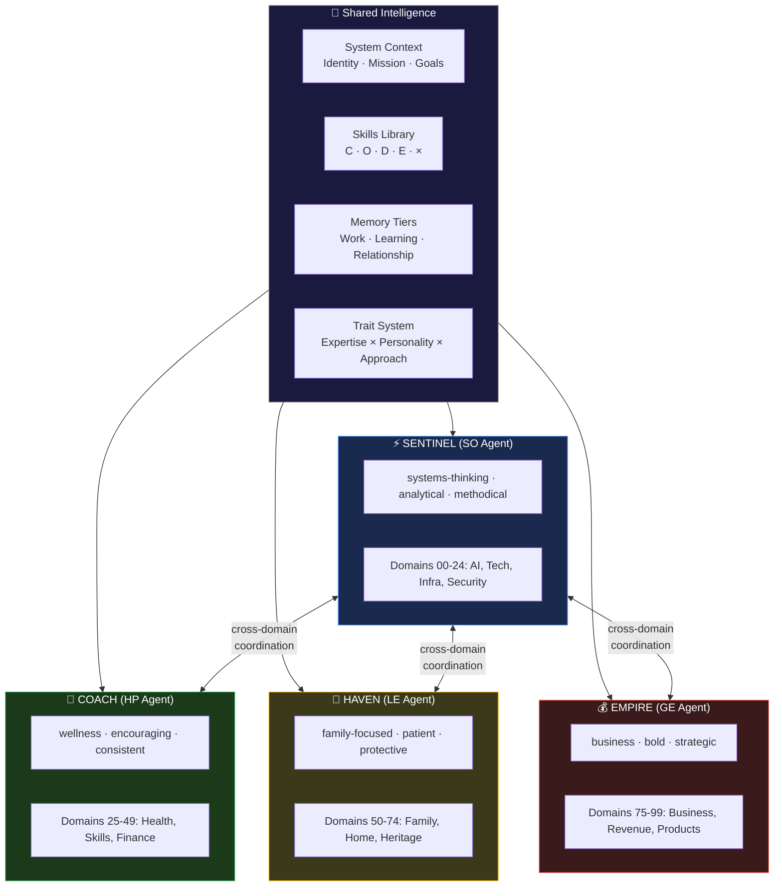
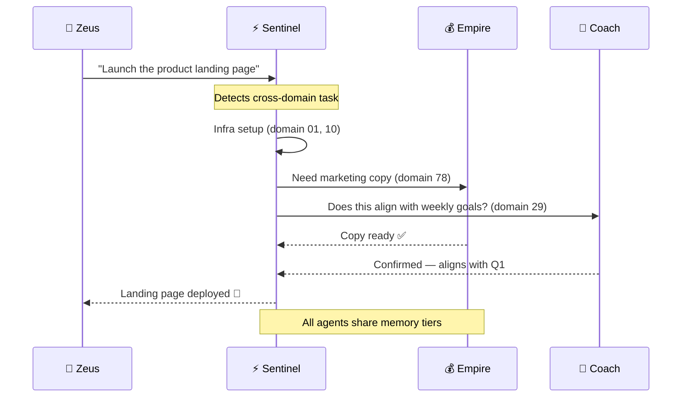

# Agent Architecture

## The Four Agents

## Cross-Domain Task Flow

## Trait Composition

Each agent is composed from 3 trait dimensions:

| Agent | Expertise | Personality | Approach |
|-------|-----------|-------------|----------|
| Sentinel | systems-thinking, security | analytical, measured | methodical |
| Coach | wellness, research | encouraging, enthusiastic | consistent |
| Haven | family-focused, creative | patient, measured | protective |
| Empire | business, research | bold, analytical | strategic |
