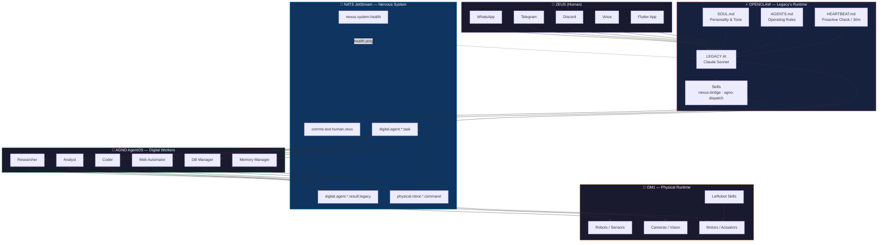

# Agent Hive Map

> The 4-runtime architecture: how Zeus reaches Legacy, how Legacy commands workers, and how everything connects through NATS JetStream.

## Key Relationships

| From | To | Via | Purpose |
|------|----|-----|---------|
| Zeus | Legacy | Any channel | Human → AI command |
| Legacy | Agno workers | NATS `digital.agent.*.task` | Delegate complex tasks |
| Workers | Legacy | NATS `digital.agent.*.result.legacy` | Return results |
| Legacy | OM1 | NATS `physical.robot.*.command` | Control physical devices |
| Legacy | Zeus | Same channel | Response / proactive nudge |
