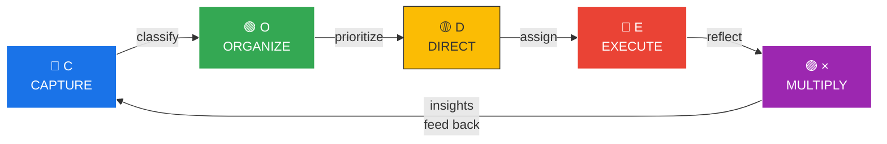
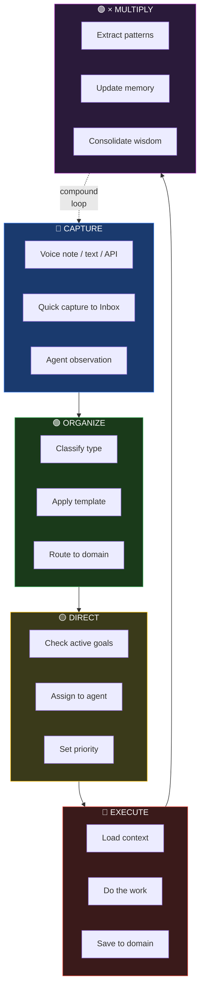

# C.O.D.E.× Method

## The Loop

## Each Stage in Detail

## Why × Multiply Matters

Most frameworks stop at **Organize** (Second Brain) or **Execute** (GTD).

OneMind's **× Multiply** is where AI extracts patterns, consolidates knowledge, and feeds insights back — making the system self-improving. Every cycle, you get smarter.
