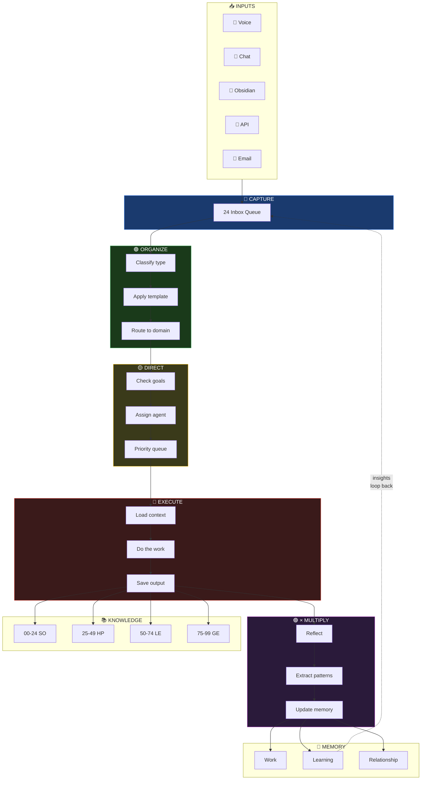

# Data Flow — How Information Moves

## The Key Insight

Information flows **one direction** through CODEX stages, but the × Multiply step creates a **feedback loop** — insights from reflection feed back into Capture. This is what makes OneMind self-improving.
