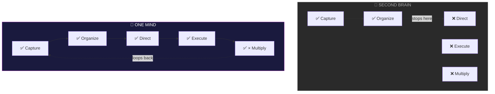
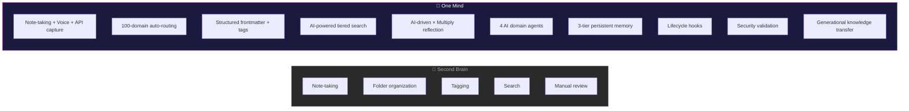

# OneMind vs Second Brain

## Feature Comparison

## The Bottom Line

| | Second Brain | One Mind |
|---|---|---|
| **What it is** | Note-taking system | Human enhancement framework |
| **AI role** | Optional add-on | Native partner |
| **Scope** | Your notes | Your entire life (100 domains) |
| **Action** | Capture + organize | Capture → organize → direct → execute → multiply |
| **Memory** | Your notebook | 3-tier AI memory that learns |
| **Agents** | None | 4 specialized domain agents |
| **Time horizon** | Your lifetime | Multi-generational |
| **Self-improving** | No | Yes — × Multiply feedback loop |

> *"They gave you a Second Brain. I'm giving you One Mind."*
