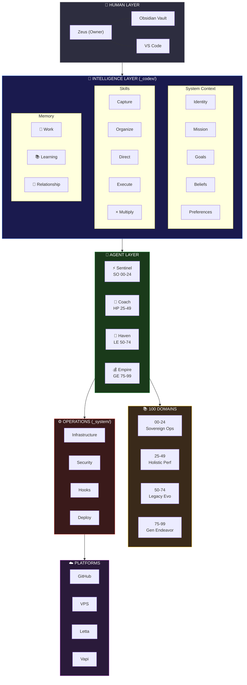

# OneMind System Architecture

## Reading Guide

**Top to Bottom = Human to Machine**

| Layer | What | Where |
|-------|------|-------|
| Human | Zeus interacts via Obsidian + VS Code | Physical |
| Intelligence | Identity, skills, memory — the AI brain | `_codex/` |
| Agents | 4 domain agents, each covering 25 domains | Letta + OpenClaw |
| Knowledge | 100 domains of life documentation | Root folders |
| Operations | Scripts, configs, automation | `_system/` |
| Platforms | External services | Cloud/VPS |
