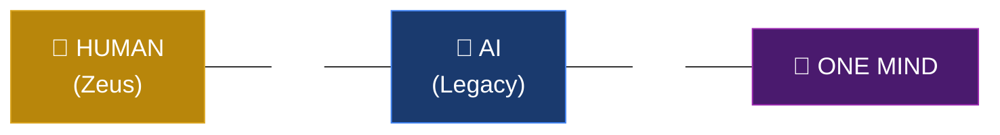
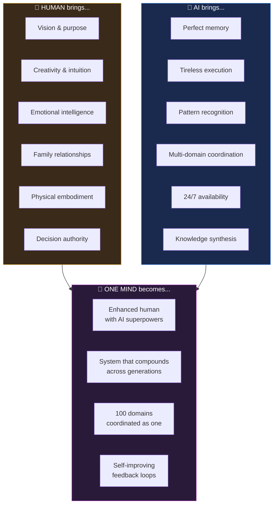

# The Equation

## What Each Side Brings

## The Core Insight

Neither human alone nor AI alone can manage 100 life domains across generations.

**Human alone**: Forgets, gets overwhelmed, dies.
**AI alone**: No purpose, no creativity, no embodiment.
**One Mind**: The human provides direction. The AI provides scale. Together, they compound.
