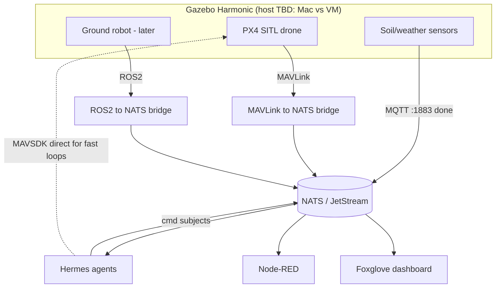

# RADS Virtual Homestead — Full Digital Twin (No-GPU)

> Status: **In progress.** Drone is flying in sim and visible in QGroundControl on the Mac ("Ready to Fly", verified 2026-05-31). Next keystone = MAVLink→NATS bridge.
> Last updated: 2026-06-01

The goal: a full **CPU-only digital twin** of the homestead — drones, ground robots, sensors, and Hermes AI agents all running in simulation, talking over NATS with **identical message schemas to the real hardware**, so policies can be validated in sim before any hardware is bought.

---

## The core concept

```
3D Homestead Model (House + Barn + Office)
        ↓
Simulation Engine (physics + sensors)
        ↓
ROS2 / MAVLink bridge
        ↓
Hermes AI Agents (decision making)
        ↓
NATS → Node-RED → Physical deploy (later)
```

The whole point of SITL (Software In The Loop): **zero code change between sim and real.** The same MAVSDK/ROS2 code that flies the simulated drone flies the physical one. The sim layer and the real layer use identical NATS message schemas.

---

## No-GPU reality check

No GPU changes the *approach*, not the *outcome*. Everything that matters is CPU-viable.

| What you lose (no RTX) | Workaround |
|---|---|
| Ray-traced visuals | Headless / lightweight renderers |
| Real-time neural rendering | Pre-baked lighting, simpler shaders |
| GPU-accelerated RL training | Train on cloud (Modal, Lambda, Colab), run inference local |
| Isaac Sim (requires RTX) | Use Gazebo / Webots / O3DE instead |

You keep everything that matters: **physics, sensors, logic, agent control, ROS2, MAVLink, NATS** — all CPU-viable.

### The REAL no-GPU constraint (important)

The constraint is **not visuals — it's simulated sensors.** Physics is cheap on CPU. The expensive thing is simulated **cameras and ray-cast lidar**, GPU or not.

| Sensor | CPU cost (headless) | Verdict on 8 vCPU |
|---|---|---|
| IMU, GPS, barometer, battery | trivial | unlimited |
| Soil moisture / weather (RADS sensors — just numbers) | trivial | unlimited |
| Depth / RGB camera | heavy | 1–2 max |
| Ray-cast lidar (Nav2 / SLAM) | heavy | 1 robot at a time |

Implication: SLAM/Nav2 on simulated lidar is where the no-GPU wall is actually felt — a **throughput** wall, not a visuals wall. Run those one robot at a time, or offload.

---

## Decisions (locked in 2026-06)

- **Sim engine = Gazebo Harmonic, NOT Webots.** Already mid-Gazebo (the PX4 image *is* Gazebo). Do not stand up Webots then migrate — that's two integrations, throw one away. Webots is genuinely nicer to start cold, but we're not cold.
- **Schema-first, not world-first.** The deliverable is the versioned NATS contract `rad.<id>.robots.<robot>.telemetry` / `.cmd`, identical sim & real. That contract is what makes this a *twin* instead of a *video game*. Build the bridge BEFORE pretty geometry.
- **Do NOT start in Blender.** House meshes teach the agents nothing and cost weeks. Use `<box>` primitives for spatial context only when nav/geofence needs it. Pretty meshes are LAST / optional.
- **Control-plane split holds:** tight loops (e.g. 50 Hz attitude) go Hermes → MAVSDK **direct** to PX4; NATS carries **coordination / state only**, never real-time stick inputs. (Same rule as: robots use Zenoh/DDS/ROS2, agents use NATS.)
- **Arm/disarm kill-switch before any agent commands a drone** — even in sim, to build the habit before real hardware. Mirrors the OpenClaw phone-control arm/disarm pattern.
- **Foxglove = telemetry dashboard; RViz2 = geometry debugger** (only for Nav2/SLAM). Not alternatives — different jobs.
- **GPU only for RL training** (Modal / Lambda / Colab). Train in cloud, pull the trained weights, run inference locally on the M2 Max.

### OPEN QUESTION — not decided (do not act without Zeus)

**Run the sim on the Mac vs keep it on the Lightsail VM.**

| | Sim on Mac (M2 Max) | Sim on Lightsail VM |
|---|---|---|
| Cost | Free (already owned) | ~$168/mo flat, idle or not |
| Latency | None — local loopback | Tailscale hop Mac↔VM |
| Always-on | No — off when laptop sleeps | Yes — runs 24/7 |
| Ties up laptop | Yes — Gazebo eats CPU | No — laptop stays free |
| Already working | Needs re-setup | Yes, drone flying now |

Deciding factor: **do we need the sim running 24/7 unattended?** If yes → VM is worth the $168. If it's only hands-on dev sessions → the Mac does it free and faster. Reversible either way. **Flagged, not blocking.**

---

## Recommended stack (CPU-optimized)

### World building — the homestead
| Tool | Role | CPU viable? |
|---|---|---|
| Blender | Model House / Barn / Office (LAST, optional) | Full |
| OpenStreetMap + JOSM | Import actual land parcel / terrain | Full |
| Cesium for O3DE | Real-world satellite terrain overlay | Software render |
| RViz2 | Lightweight 3D viewer inside ROS2 (geometry debug) | Full |
| Foxglove Studio | Visual monitoring of robots / telemetry | Full |

Path when geometry is actually needed: model in Blender → export URDF/SDF/OBJ → import into Gazebo. **Not yet — primitives first.**

### Simulation engine
| Tool | CPU load | Best for |
|---|---|---|
| **Gazebo Harmonic** (chosen) | Medium | Full ROS2 + MAVLink, sensor sim |
| Webots | Low–Med | Easy multi-robot, Python API (rejected: avoid double integration) |
| O3DE | Medium | Game-quality world, ROS2 plugin |
| CoppeliaSim | Low | Fast, scriptable, arms/fleet |
| PyBullet | Very low | Headless physics only, no visuals |

### Drones in the world
| Tool | Role |
|---|---|
| **PX4 SITL** | Full drone firmware in sim, MAVLink native (running now) |
| ArduPilot SITL | Lighter alternative |
| MAVSDK-Python | Agent controls drone via Python → same code on real hardware |
| QGroundControl | Visual mission planner connected to sim (connected now) |

### Ground robots
| Tool | Role |
|---|---|
| Nav2 | Autonomous nav stack (DIMOS / Go2 / OM1) |
| SLAM Toolbox | Build map of homestead from sensor data |
| MoveIt2 | Arm / manipulation planning |
| micro-ROS | Bridge to embedded hardware later |

---

## AI agent control layer

```
Hermes Agent
    ↓ MAVSDK / ROS2 Python
Drone Agent          Ground Robot Agent       Greenhouse Agent
    ↓                       ↓                       ↓
PX4 SITL             Gazebo robot              AquaCrop model
    ↓                       ↓                       ↓
              NATS message bus (already running)
                            ↓
                   Node-RED (already running)
                            ↓
                HomeAssistant (already connected)
```



The dotted line matters: for tight control loops Hermes talks **MAVSDK direct** to PX4; NATS is for coordination/state, not real-time control.

---

## Where we actually are (ahead of the original plan)

The original written plan put "drone autonomy" at Month 2. **It's already done.** PX4 + Gazebo → MAVLink UDP over Tailscale → QGroundControl on the Mac → "Ready to Fly", verified 2026-05-31. Re-sequence around that reality.

### Verified working drone config (cloud VM)
- Image: `jonasvautherin/px4-gazebo-headless:1.14.0`, container `px4-drone`, `--restart unless-stopped`, **bridge networking**.
- Run cmd: `docker run -d --name px4-drone --restart unless-stopped jonasvautherin/px4-gazebo-headless:1.14.0 100.98.178.23 100.98.178.23`
- **Gotchas:**
  - Arg order is QGC-port-first: 1st IP → 14550 (QGC), 2nd IP → 14540 (MAVSDK/API). A **single IP arg is a trap** — it sends 14540 to your IP and 14550 to the docker host gateway, so QGC gets nothing. Pass the Mac IP **twice**.
  - `--network host` **breaks** it — image then broadcasts only to the VM gateway and ignores the arg. Use default bridge net.
  - macOS firewall **stealth mode must be OFF** (System Settings → Network → Firewall → Options) or it silently drops inbound MAVLink UDP. This was the original blocker.
  - Verify from VM: `sudo timeout 5 tcpdump -ni any "udp and dst port 14550" | grep -Eo "> [0-9.]+\.14550"` should show `> 100.98.178.23.14550`.

### Network facts
- VM `onemind-rads-worldsim-01`: Lightsail Ubuntu 24.04, 8 vCPU / 30 GB, public IP 13.223.102.62, Tailscale 100.75.87.51.
- Mac (M2 Max): Tailscale 100.98.178.23.
- PX4 ports: **14540 = MAVSDK/API** (this is what the bridge connects to), **14550 = QGC**.

---

## Build sequence (re-sequenced to reality)

| Order | Step | Why |
|---|---|---|
| 1 | *(optional/parallel)* Settle Mac-vs-VM host question | Cost decision, not blocking |
| 2 | **MAVLink → NATS bridge** with versioned schema (KEYSTONE) | Everything downstream depends on it |
| 3 | One agent, one drone, **closed loop** | "AI in the loop" proof, this-week achievable |
| 4 | Add 2nd robot sharing the same schema | Proves multi-agent coordination |
| 5 | Primitive `<box>` world (barn/field as boxes) | Cheap spatial context |
| 6 | Pretty Blender meshes (optional) | Pure cosmetics, last |

### Next 3 moves (resume here)

1. *(optional)* Settle the Mac-vs-VM cost question above.
2. **Build the MAVLink→NATS bridge** (MAVSDK-Python). Drone telemetry → `rad.<id>.robots.drone1.telemetry`; commands ← `rad.<id>.robots.drone1.cmd`. The drone is already flying and reachable on **14540**. Include **sim-clock / time-sync** awareness in the schema (Gazebo can run faster/slower than wall-clock, so "act in 5s" needs a clock reference).
3. **Prove the closed loop** — Hermes reads telemetry from NATS, sends one `takeoff`/`goto` via MAVSDK, confirms via telemetry.

---

## Cloud GPU — training only

For RL (teaching robots to walk, drones to dodge obstacles):
- **Modal** — Isaac Lab / MuJoCo headless, pay per second
- **Lambda Labs** — cheap GPU hours, SSH in, train, pull weights
- **Google Colab** — free T4, fine for AquaCrop / lightweight models

Train in cloud → deploy the trained policy locally. The M2 Max runs inference fine.

---

## Related / already-working pieces

- **Phase 1 proof (DONE, on Mac):** `~/onemind/rads-sim/` docker-compose = `soil_sensor.py` + `land_agent.py` → Mac NATS MQTT `:1883` (**MQTT 3.1.1 only, NOT v5**) → subjects `rad.demo.land.*`.
- **NATS + JetStream** on Mac with MQTT interface on 1883. MQTT topic `rad/demo/land/soil/moisture` → NATS subject `rad.demo.land.soil.moisture`.
- **Architecture principle:** NATS = coordination / brain / state layer (NOT real-time robot control). Robots use Zenoh/DDS/ROS2; sensors use MQTT; agents (Hermes) speak only NATS + MCP/A2A; a bridge per device-type translates.

## Housekeeping / security TODO

- **Rotate** the Lightsail `.pem` key (was shared in plaintext).
- **Stop / snapshot** the VM when not testing (~$168/mo flat).
- Later: optionally fold the VM into self-hosted netbird instead of Tailscale.
