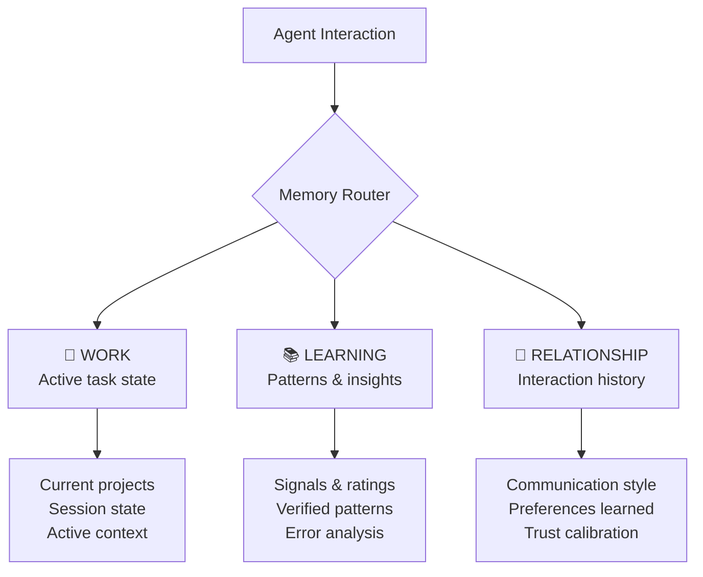

# Upgrade 02: 3-Tier Memory Architecture

> ✅ **DEPLOYED** to `_codex/memory/` — commit `28356c78` (2026-03-27)

> **Source**: PAI's MEMORY system (WORK / LEARNING / RELATIONSHIP tiers)
> **Destination**: `_codex/memory/`
> **Why**: OneMind has no persistent memory layer in the vault itself. Letta agents have memory, but the vault — the source of truth — doesn't track what agents learn over time. This creates a structured place for it.

---

## The 3 Tiers



### Tier 1: WORK (Active State)
**What**: Current task tracking, project state, session context
**Lifecycle**: Created when work starts, archived when done
**Format**: JSON + Markdown

### Tier 2: LEARNING (Patterns & Insights)
**What**: Patterns extracted from work, lessons learned, preference signals
**Lifecycle**: Grows over time, never deleted — only consolidated
**Format**: JSONL (append-only log) + Markdown summaries

### Tier 3: RELATIONSHIP (Interaction History)
**What**: How Zeus communicates, what he responds well to, trust levels with each agent
**Lifecycle**: Updated after significant interactions
**Format**: Markdown notes

---

## Directory Structure

```
_codex/memory/
├── README.md              ← This explanation
├── work/
│   ├── .gitkeep
│   └── current-focus.json ← What's active right now
├── learning/
│   ├── .gitkeep
│   ├── signals.jsonl      ← Feedback log (append-only)
│   └── patterns.md        ← Consolidated learned patterns
└── relationship/
    ├── .gitkeep
    └── interaction-notes.md ← Agent observations about working with Zeus
```

## How It Works

### On Session Start
1. Agent loads `_codex/system/` (identity files)
2. Agent reads `memory/work/current-focus.json` for active context
3. Agent scans recent entries in `memory/learning/signals.jsonl`

### During Session
1. Agent writes task progress to `memory/work/`
2. When Zeus gives feedback (explicit or implicit), log to `memory/learning/signals.jsonl`

### On Session End
1. Extract lessons → append to `memory/learning/signals.jsonl`
2. Update `memory/relationship/interaction-notes.md` if preferences were revealed
3. Archive completed work from `memory/work/`

---

## How to Deploy

1. Create `_codex/memory/` directory structure
2. Copy the template files from this module
3. Agents begin writing to it immediately
4. Review `signals.jsonl` weekly during × Multiply reviews

## PAI Equivalent

PAI stores memory at `~/.claude/PAI/MEMORY/` with WORK, LEARNING, RELATIONSHIP, STATE, and VOICE tiers. We adapted to 3 tiers (no voice tier since we use Vapi, no separate state tier since work covers it).
