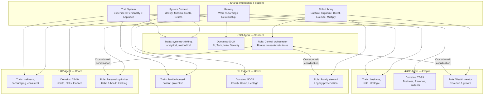
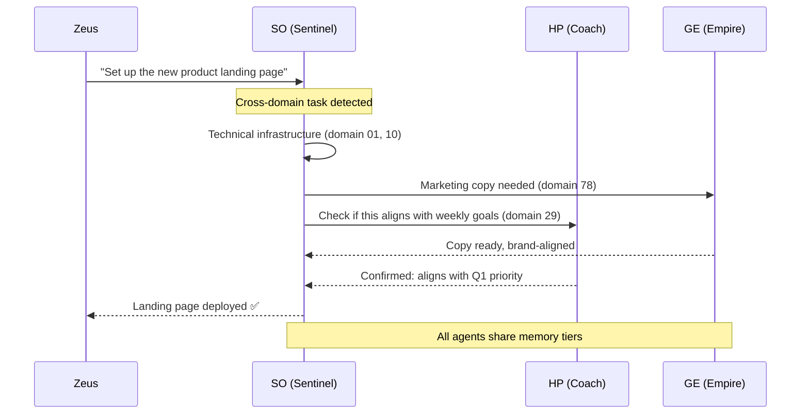

# Agent Architecture

## The Pattern

- **Each agent owns 25 domains** — clear boundaries, no overlap
- **SO is the router** — cross-domain tasks go through Sentinel
- **All agents share** — identity context, skills, memory, and traits
- **Traits differentiate** — same skills, different personality and approach
