# OneMind System Architecture

```mermaid
graph TB
    subgraph "👤 HUMAN LAYER"
        Z[Zeus / Owner]
        OBS[Obsidian Vault]
        VSC[VS Code]
    end

    subgraph "🧠 INTELLIGENCE LAYER (_codex/)"
        subgraph "System Context (Always Loaded)"
            ID[Identity]
            MISS[Mission]
            GOALS[Active Goals]
            BEL[Beliefs]
            PREF[Preferences]
        end
        
        subgraph "Skills"
            CAP[Capture]
            ORG[Organize]
            DIR[Direct]
            EXE[Execute]
            MUL[× Multiply]
        end

        subgraph "Memory"
            MW[Work Tier]
            ML[Learning Tier]
            MR[Relationship Tier]
        end

        PROF[Agent Profiles]
        TMPL[Templates]
    end

    subgraph "🤖 AGENT LAYER"
        SO_A[SO Agent<br/>Sovereign Operations]
        HP_A[HP Agent<br/>Holistic Performance]
        LE_A[LE Agent<br/>Legacy Evolution]
        GE_A[GE Agent<br/>Generational Empire]
    end

    subgraph "📚 KNOWLEDGE LAYER (100 Domains)"
        SO[00-24 SO<br/>The Brain]
        HP[25-49 HP<br/>Self Path]
        LE[50-74 LE<br/>Legacy Path]
        GE[75-99 GE<br/>Wealth Path]
    end

    subgraph "⚙️ OPERATIONS LAYER (_system/)"
        INFRA[Infrastructure]
        SEC[Security]
        HOOKS[Lifecycle Hooks]
        DEPLOY[Deploy Scripts]
    end

    subgraph "☁️ PLATFORM LAYER"
        VPS[VPS / Self-Hosted]
        GH[GitHub]
        LETTA[Letta Memory]
        VAPI[Vapi Voice]
    end

    Z --> OBS
    Z --> VSC
    OBS --> |reads/writes| SO & HP & LE & GE
    
    SO_A --> SO
    HP_A --> HP
    LE_A --> LE
    GE_A --> GE
    
    SO_A & HP_A & LE_A & GE_A --> |load context| ID & MISS & GOALS
    SO_A & HP_A & LE_A & GE_A --> |use skills| CAP & ORG & DIR & EXE & MUL
    SO_A & HP_A & LE_A & GE_A --> |read/write| MW & ML & MR
    
    GH --> |sync| VPS
    SO_A --> INFRA & SEC & HOOKS
    
    LETTA --> |memory blocks| SO_A & HP_A & LE_A & GE_A
    VAPI --> |voice| Z
```

## How to Read This

**Top → Bottom = Human → Machine**

1. **Human Layer** — Zeus interacts via Obsidian (visual) and VS Code (code)
2. **Intelligence Layer** — `_codex/` provides identity, skills, memory, and templates
3. **Agent Layer** — 4 domain agents, each responsible for 25 domains
4. **Knowledge Layer** — 100 domains organized in 3 life paths + 1 operations layer
5. **Operations Layer** — `_system/` runs infrastructure, security, and automation
6. **Platform Layer** — External services (VPS, GitHub, Letta, Vapi)
