# CODEX Method Flow

```mermaid
graph TD
    subgraph "C — CAPTURE"
        C1[Voice note]
        C2[Quick capture]
        C3[Agent observation]
        C4[External data]
        C_OUT[→ Inbox]
    end
    
    subgraph "O — ORGANIZE"
        O1[Classify type]
        O2[Apply template]
        O3[Add frontmatter]
        O4[Route to domain]
        O_OUT[→ Domain folder]
    end
    
    subgraph "D — DIRECT"
        D1[Review priorities]
        D2[Check active goals]
        D3[Assign to agent]
        D4[Set deadlines]
        D_OUT[→ Task queue]
    end
    
    subgraph "E — EXECUTE"
        E1[Agent picks up task]
        E2[Load context]
        E3[Do the work]
        E4[Document output]
        E_OUT[→ Completed work]
    end
    
    subgraph "× — MULTIPLY"
        X1[Daily reflection]
        X2[Extract patterns]
        X3[Update memory]
        X4[Consolidate knowledge]
        X_OUT[→ Compounding wisdom]
    end
    
    C_OUT --> O1
    O_OUT --> D1
    D_OUT --> E1
    E_OUT --> X1
    X_OUT --> |"New insights feed back"| C1
```

## The Key Insight

Most systems stop at **Organize** (Second Brain) or **Execute** (GTD). OneMind goes to **× Multiply** — the review and compounding step where AI extracts patterns, consolidates knowledge, and feeds insights back into the system. This is what makes the framework self-improving.
