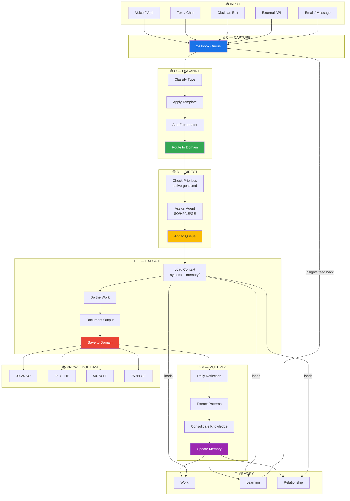

# Data Flow

## The Loop

Information enters → gets processed through CODEX stages → lands in a domain → gets reviewed → generates new insights → feeds back in. **The system gets smarter with every cycle.**
