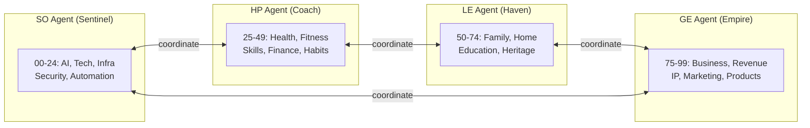

# Domain Map

```mermaid
graph TD
    ROOT[🧠 OneMind Codex<br/>100 Domains]
    
    ROOT --> SO[⚡ 00-24 SO<br/>Sovereign Operations<br/>The Brain]
    ROOT --> HP[💪 25-49 HP<br/>Holistic Performance<br/>Self Path]
    ROOT --> LE[🏡 50-74 LE<br/>Legacy Evolution<br/>Legacy Path]
    ROOT --> GE[💰 75-99 GE<br/>Generational Empire<br/>Wealth Path]
    
    SO --> SO1[00 Framework]
    SO --> SO2[01 Infrastructure]
    SO --> SO3[02 Command Center]
    SO --> SO4[03 Agents]
    SO --> SO5[04 Resources]
    SO --> SO6[05 Environments]
    SO --> SO7[06 Protocols]
    SO --> SO8[09 Automation]
    SO --> SO9[10 Development]
    SO --> SO10[11 Security]
    SO --> SO11[12 Research]
    SO --> SO12[24 Inbox]
    
    HP --> HP1[25 Philosophy]
    HP --> HP2[26 Habits]
    HP --> HP3[27 Health & Fitness]
    HP --> HP4[28 Mastery]
    HP --> HP5[29 Life Systems]
    HP --> HP6[30 Finance]
    HP --> HP7[... more domains]
    
    LE --> LE1[50 Family Core]
    LE --> LE2[51 Parenting]
    LE --> LE3[52 Home]
    LE --> LE4[53 Education]
    LE --> LE5[54 Heritage]
    LE --> LE6[... more domains]
    
    GE --> GE1[75 Business Strategy]
    GE --> GE2[76 Revenue]
    GE --> GE3[77 IP & Holdings]
    GE --> GE4[78 Marketing]
    GE --> GE5[79 Partnerships]
    GE --> GE6[80 Products]
    GE --> GE7[82 Investments]
    GE --> GE8[... more domains]
    
    style SO fill:#4285f4,stroke:#fff,color:#fff
    style HP fill:#34a853,stroke:#fff,color:#fff
    style LE fill:#fbbc04,stroke:#333,color:#333
    style GE fill:#ea4335,stroke:#fff,color:#fff
```

## Agent Coverage

## The 3+1 Architecture

- **3 Life Domains**: HP (Self) + LE (Family) + GE (Wealth) = your whole life
- **1 Operations Layer**: SO = the brain that coordinates everything
- **Not "4 equal parts"** — SO serves the other 3. It's the operating system, not a life domain.
