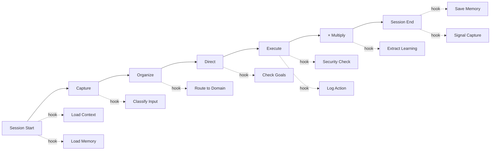

# Upgrade 05: Lifecycle Hooks

> ✅ **DEPLOYED** to `_system/hooks/` — commit `28356c78` (2026-03-27)

> **Source**: PAI's 22 hooks across 6 lifecycle events
> **Destination**: `_system/hooks/`
> **Why**: OneMind has no event-driven automation. PAI fires hooks on session start, user input, tool use, response, and session end. We adapt this to fire hooks at each CODEX stage, creating an event-driven enhancement framework.

---

## OneMind Lifecycle Events



## The 10 OneMind Hooks

| # | Hook | Event | Purpose | PAI Equivalent |
|---|------|-------|---------|----------------|
| 1 | `LoadContext` | Session Start | Load `_codex/system/` into agent context | LoadContext.hook.ts |
| 2 | `LoadMemory` | Session Start | Load `_codex/memory/` tiers | LoadContext.hook.ts |
| 3 | `ClassifyInput` | Capture | Determine input type (note, decision, SOP, etc.) | — (new) |
| 4 | `RouteToDomain` | Organize | Auto-suggest destination domain | — (new) |
| 5 | `CheckGoals` | Direct | Compare task against active-goals.md | — (new) |
| 6 | `SecurityValidate` | Execute (pre) | Validate command safety before execution | SecurityValidator.hook.ts |
| 7 | `LogAction` | Execute (post) | Record what was done | WorkCompletionLearning |
| 8 | `ExtractLearning` | × Multiply | Pull patterns from completed work | WorkCompletionLearning |
| 9 | `SaveMemory` | Session End | Persist memory tier updates | RelationshipMemory |
| 10 | `CaptureSignal` | Session End | Log feedback signals | RatingCapture.hook.ts |

## Hook Definition Format

```yaml
# _system/hooks/hooks.yaml
hooks:
  session-start:
    - name: LoadContext
      description: "Load all _codex/system/ files into agent context"
      blocking: true
      fail_behavior: abort
      
    - name: LoadMemory
      description: "Load memory tiers (work, learning, relationship)"
      blocking: false
      fail_behavior: log
      
  capture:
    - name: ClassifyInput
      description: "Determine input type and suggest template"
      blocking: false
      fail_behavior: skip

  execute-pre:
    - name: SecurityValidate
      description: "Check command against security patterns"
      blocking: true
      fail_behavior: abort

  session-end:
    - name: SaveMemory
      description: "Persist memory updates to vault"
      blocking: true
      fail_behavior: retry

    - name: CaptureSignal
      description: "Log explicit and implicit feedback"
      blocking: false
      fail_behavior: log
```

## Directory Structure

```
_system/hooks/
├── README.md           ← This explanation
├── hooks.yaml          ← Hook registry and configuration
├── load-context.md     ← Hook #1 implementation
├── load-memory.md      ← Hook #2 implementation
├── classify-input.md   ← Hook #3 implementation
├── route-to-domain.md  ← Hook #4 implementation
├── check-goals.md      ← Hook #5 implementation
├── security-validate.md← Hook #6 implementation
├── log-action.md       ← Hook #7 implementation
├── extract-learning.md ← Hook #8 implementation
├── save-memory.md      ← Hook #9 implementation
└── capture-signal.md   ← Hook #10 implementation
```

## Implementation Note

PAI's hooks are TypeScript files executed by Claude Code. OneMind's hooks are markdown instruction files that agents follow. The paradigm is different:
- **PAI**: Code executes automatically via Claude's hook system
- **OneMind**: Agent reads hook instructions and executes the defined steps

When OneMind agents gain native hook execution (e.g., Letta's hooks, or Claude Code integration), these can be converted to executable code.

## How to Deploy

1. Create `_system/hooks/` directory
2. Copy `hooks.yaml` and all hook `.md` files
3. Update agent instructions (AGENTS.md) to reference hooks
4. Agents check hooks at each lifecycle stage
