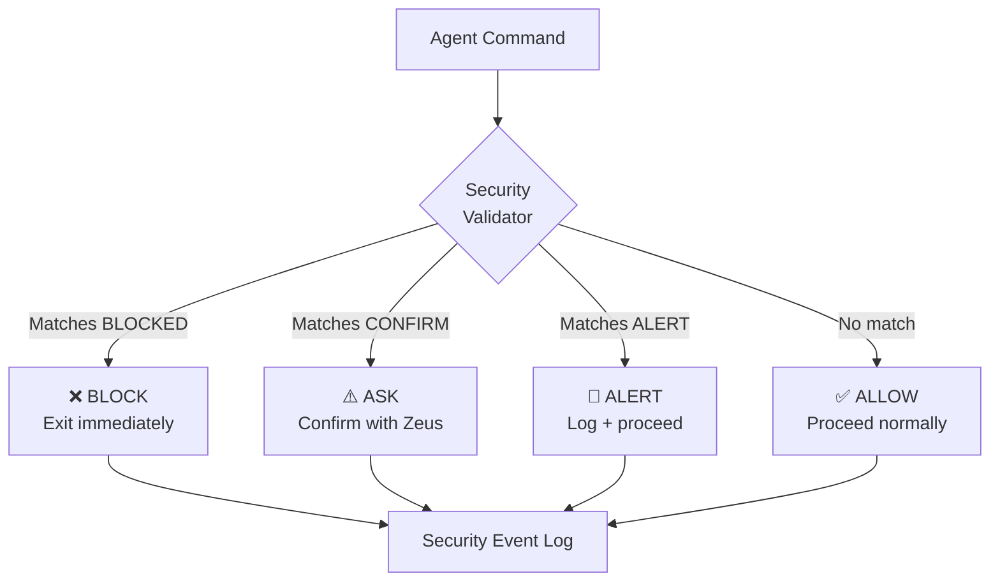

# Upgrade 06: Security Validation Gate

> ✅ **DEPLOYED** to `_system/security/` — commit `28356c78` (2026-03-27)

> **Source**: PAI's SecurityValidator hook + patterns.yaml
> **Destination**: `_system/security/`
> **Why**: OneMind handles personal, family, and financial data across 100 domains. There's currently no active security layer — just documentation in domain 11. PAI validates every command against a pattern file and logs all security events. We need this.

---

## Architecture



## Security Patterns

```yaml
# _system/security/patterns.yaml
version: "1.0"
updated: "2026-03-27"
philosophy: "Protect what matters. Don't slow down what doesn't."

bash_patterns:
  blocked:
    - pattern: "rm -rf /"
      reason: "System destruction"
    - pattern: "rm -rf ~"
      reason: "Home directory destruction"
    - pattern: "gh repo delete"
      reason: "Repository destruction"
    - pattern: "diskutil eraseDisk"
      reason: "Disk destruction"
    - pattern: "DROP DATABASE"
      reason: "Database destruction"
      
  confirm:
    - pattern: "git push --force"
      reason: "Force push overwrites history"
    - pattern: "terraform destroy"
      reason: "Infrastructure destruction"
    - pattern: "DELETE FROM"
      reason: "Data deletion"
    - pattern: "DROP TABLE"
      reason: "Schema destruction"
    - pattern: "TRUNCATE"
      reason: "Data truncation"
      
  alert:
    - pattern: "curl | sh"
      reason: "Remote code execution"
    - pattern: "wget | bash"
      reason: "Remote code execution"
    - pattern: "sudo"
      reason: "Elevated privileges"

path_protection:
  zero_access:
    - "~/.ssh/*"
    - "~/.aws/credentials"
    - "*.pem"
    - "*.key"
    - "**/secrets/**"
    
  read_only:
    - "/etc/**"
    - ".obsidian/workspace.json"
    
  confirm_write:
    - ".env*"
    - "ONEMIND-CODEX.md"
    - "_codex/system/**"
    - "**/*password*"
    - "**/*secret*"
    
  no_delete:
    - ".git/**"
    - "_codex/system/**"
    - "ONEMIND-CODEX.md"
    - "AGENTS.md"
    - "CLAUDE.md"
    - "README.md"
    - "LICENSE*"

vault_rules:
  never_commit:
    - "API keys or tokens"
    - "Passwords"
    - "Private keys"
    - "1Password references with actual values"
  
  always_confirm:
    - "Renaming root quadrant folders"
    - "Deleting domain folders"
    - "Modifying _codex/system/ pinned files"
    - "Editing ONEMIND-CODEX.md"
```

## Security Event Log Format

```jsonl
{"timestamp":"2026-03-27T12:00:00Z","event":"blocked","command":"rm -rf /","reason":"System destruction","agent":"so-sentinel"}
{"timestamp":"2026-03-27T12:01:00Z","event":"confirmed","command":"git push --force","reason":"Force push","agent":"so-sentinel","approved_by":"zeus"}
{"timestamp":"2026-03-27T12:02:00Z","event":"allowed","command":"git commit -m 'update'","agent":"ge-empire"}
```

## Directory Structure

```
_system/security/
├── README.md           ← This explanation
├── patterns.yaml       ← Security patterns (what to block/confirm/alert)
├── validator.md        ← How agents validate commands (instruction file)
└── events/
    └── .gitkeep        ← Security event logs go here
```

## How to Deploy

1. Create `_system/security/` directory
2. Copy `patterns.yaml` and `validator.md`
3. Update AGENTS.md to reference security validation
4. Agents check patterns before executing destructive commands

## PAI Equivalent

PAI's `SecurityValidator.hook.ts` (619 lines) validates every Bash, File Write, and Read operation against `patterns.yaml`. It runs in <10ms. Our version is instruction-based (agents read and follow patterns) rather than code-based, but achieves the same protection.
