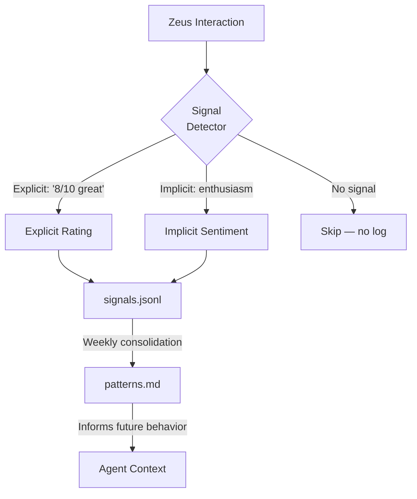

# Upgrade 08: Signal Capture System

> ✅ **DEPLOYED** to `_codex/memory/learning/` — commit `28356c78` (2026-03-27)

> **Source**: PAI's RatingCapture hook (22,648 bytes) — captures explicit + implicit feedback
> **Destination**: `_codex/memory/learning/`
> **Why**: OneMind currently has no feedback loop. Agents do work but never learn what Zeus liked or didn't. PAI captures both explicit ratings ("8/10 great work") and implicit sentiment. This is what makes a system *learn*.

---

## How It Works



## Signal Types

### Explicit Signals
Zeus directly rates or evaluates work:
- "Great work" / "This is exactly what I wanted" → positive, high
- "8/10" or "9 out of 10" → numeric rating
- "Not what I meant" / "Try again" → negative, correction needed
- "Perfect, commit it" → positive, complete

### Implicit Signals
Inferred from behavior:
- **Accepted without changes** → positive signal
- **Immediately asked for revision** → negative signal
- **Expanded on the topic** → interest signal (learn more about this)
- **Changed subject** → neutral/disinterest signal
- **Used enthusiastic language** → high satisfaction
- **Asked clarifying questions** → ambiguity signal (be clearer next time)

## Signal Format

```jsonl
{"ts":"2026-03-27T15:30:00Z","type":"explicit","rating":9,"signal":"exactly what I wanted","context":"skill-packs-creation","agent":"copilot","domain":"03-agents"}
{"ts":"2026-03-27T15:35:00Z","type":"implicit","rating":null,"signal":"accepted without changes","context":"security-patterns","agent":"copilot","domain":"11-security"}
{"ts":"2026-03-27T15:40:00Z","type":"explicit","rating":3,"signal":"not what I meant, redo","context":"naming-convention","agent":"so-sentinel","domain":"00-framework"}
```

## Fields

| Field | Type | Description |
|-------|------|-------------|
| `ts` | ISO 8601 | Timestamp |
| `type` | `explicit` / `implicit` | How the signal was detected |
| `rating` | 1-10 or null | Numeric rating (null for implicit) |
| `signal` | string | What Zeus said or did |
| `context` | string | What task/topic this relates to |
| `agent` | string | Which agent captured this |
| `domain` | string | Which domain was involved |

## Consolidation (Weekly during × Multiply)

Every week, process `signals.jsonl`:

1. **Count** — How many positive vs negative signals this week?
2. **Pattern** — What types of work get the best ratings?
3. **Domain heat map** — Which domains get the most attention?
4. **Agent performance** — Which agent gets the best feedback?
5. **Update** `patterns.md` with new consolidated insights
6. **Archive** old signals (move to `learning/archive/YYYY-MM/`)

## How to Deploy

1. Ensure `_codex/memory/learning/` exists
2. `signals.jsonl` is append-only (never edit, only append)
3. Agents log signals at session end (CaptureSignal hook)
4. Review weekly during × Multiply reflection

## PAI Equivalent

PAI's `RatingCapture.hook.ts` (22KB) tries explicit regex matching first ("8 - great"), then falls back to Haiku inference for implicit sentiment. Writes to `MEMORY/LEARNING/SIGNALS/ratings.jsonl`. We simplify to a lighter-weight version that agents can execute without external inference calls.
